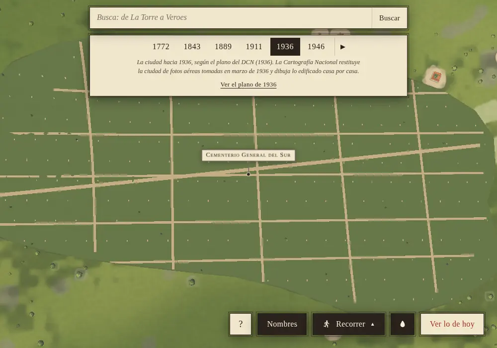
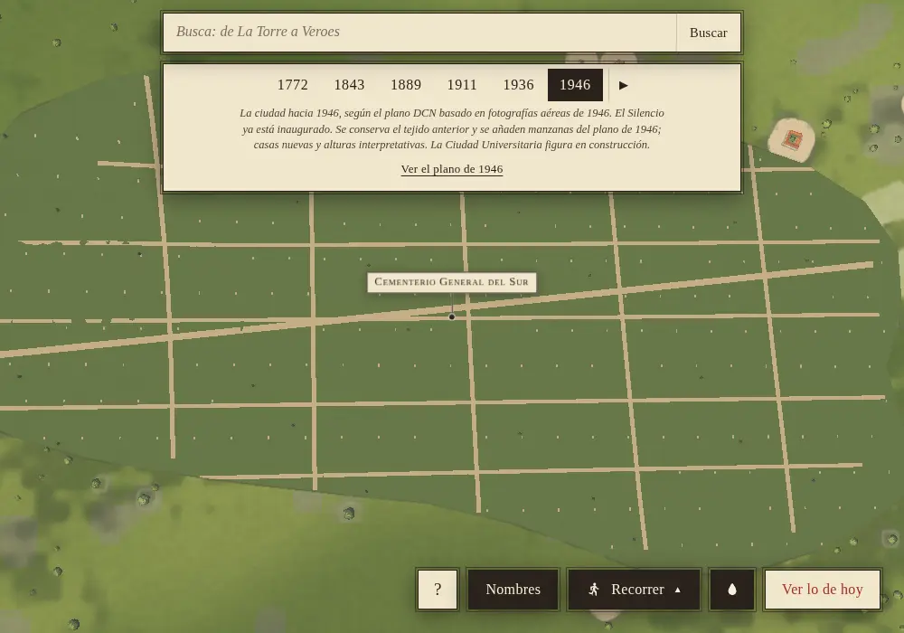
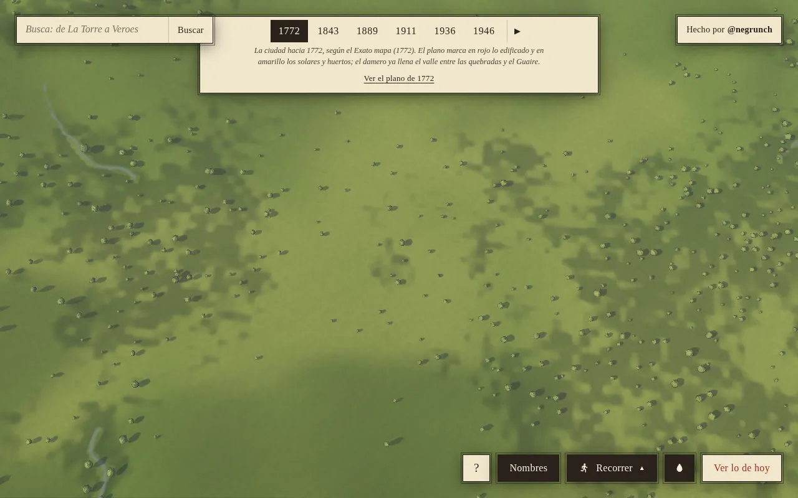
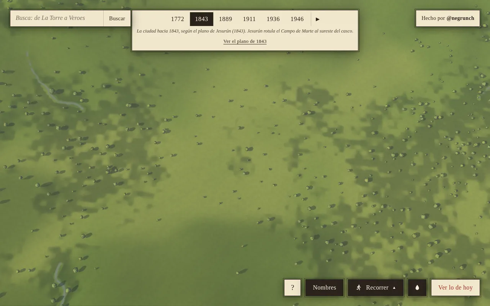
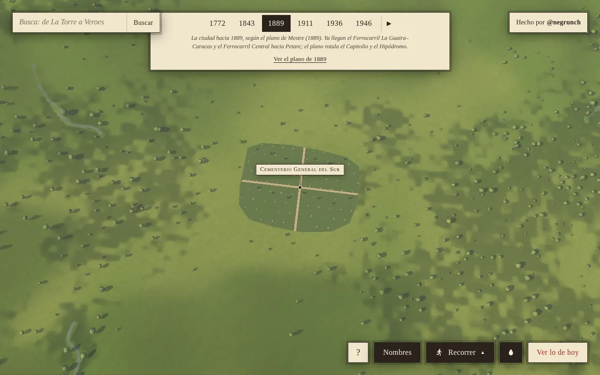
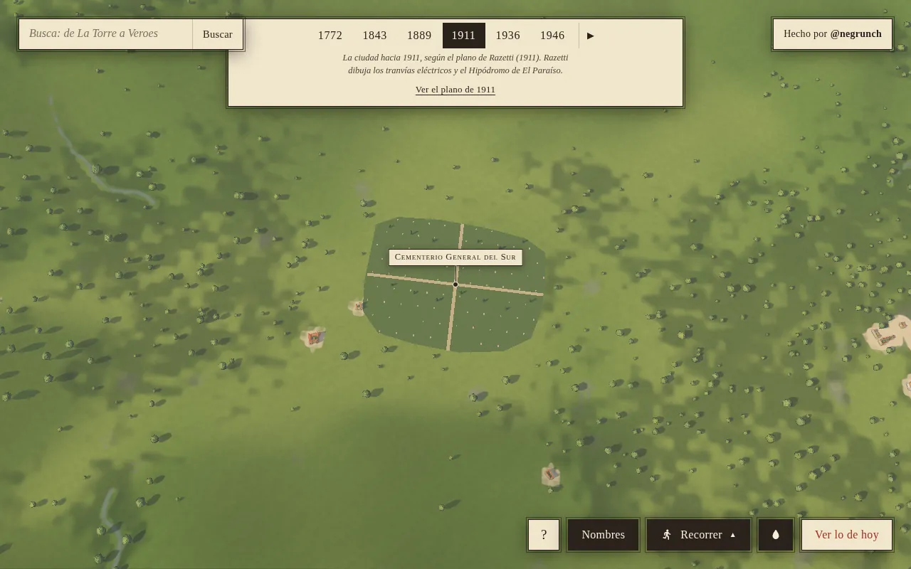
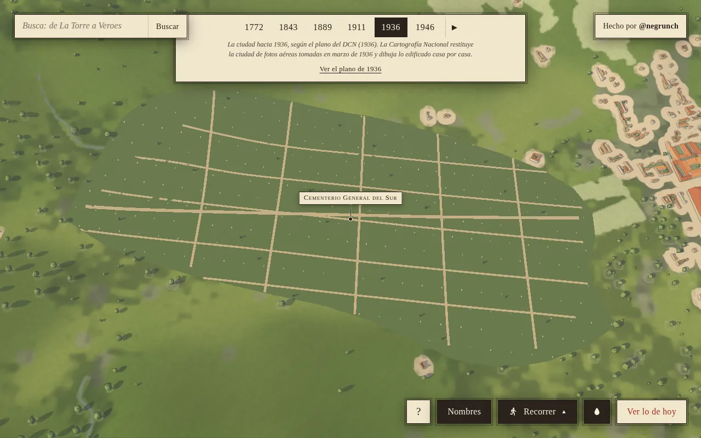
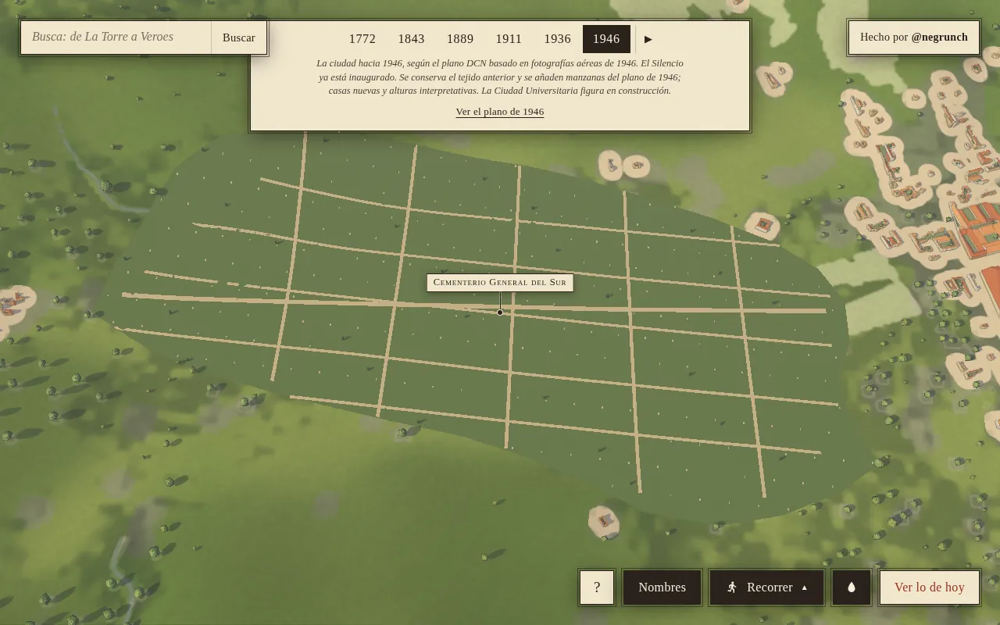

# Integración del Cementerio General del Sur

Issue relacionado: [#250](https://github.com/grunch/caracas/issues/250). El General del Sur se integró por el [PR #288](https://github.com/grunch/caracas/pull/288) (fusionado el 27-11-2026) y Hijos de Dios por el #287; los datos se publicaron después (`datos-2026-11-27-eb21bf8`). El 28-11-2026 se añadieron la [cronología documentada](#cronología-documentada-y-límites-de-la-huella), el [cotejo con el plano de 1946](#cotejo-con-el-plano-de-1946), el [registro de referencias visuales](#referencias-visuales-imagen-por-imagen) y las capturas de las seis épocas. Lo que sigue abierto está en [Qué falta](#qué-falta).

## Evidencia por fase

- **1889 y 1911:** el cementerio existe desde 1876. Los mapas urbanos consultados no cubren el sitio con detalle medible. Rodríguez describe cuatro cuarteles y dos avenidas de cuatro metros, pero no da una localización precisa ni ejes para este núcleo. Se cruzan dos vías esquemáticas para sugerir la división en cuatro; el contorno, la posición y la orientación son interpretativos.
- **1936:** el plano DCN dibuja el campo funerario al sur de la ciudad, con bordes adaptados al relieve, calles internas, arbolado y crecimiento irregular. `CONTORNO_SUR_1936` y `CALLES_SUR_1936` son una digitalización aproximada de esa hoja, no un deslinde catastral.
- **1946:** el ejemplar de Princeton está restringido, pero el repo ya tenía otro ejemplar de la misma hoja ([Internet Archive, WCWdb_18051](https://archive.org/details/WCWdb_18051), `fuentes/mapas/1950-archiveorg-plano-de-caracas-dcn`), calzado para la época 1946. Se cotejó el 28-11-2026 ([abajo](#cotejo-con-el-plano-de-1946)): el núcleo y la trama de calles coinciden con 1936, así que se conserva ese trazado; el plano de 1946 dibuja además campos nuevos al norte que el modelo no representa.
- Las sepulturas, panteones genéricos y árboles no representan un inventario ni se atribuyen a familias concretas. No se modela una portada monumental sin alzado histórico demostrado.
- El césped del recinto usa un patrón plano propio; no hereda los canteros en cruz y X de las plazas. Las vías se recortan en el contorno irregular para no prolongarlas sobre las laderas.

## Cronología documentada y límites de la huella

Viene del estudio de Miraflores (`docs/prioridades/cementerio-sur.md`). La columna del documento distingue la
fecha del hecho de la fecha de quien lo cuenta: casi todo sale de la transcripción de Landaeta Rosales (1906) que
publica la [Cámara de Caracas](https://camaradecaracas.com/la-camara-caracas-y-sus-historias/ocurrio-aqui/origenes-del-cementero-general-del-sur-en-caracas-1875-1904/); el original de 1906 no se cotejó.

| Fecha del hecho | Documento (fecha del documento) | Qué permite representar | Qué no demuestra | Certeza |
|---|---|---|---|---|
| 5-07-1876 | Landaeta Rosales (1906), transcrito por la Cámara de Caracas | Que el cementerio existe antes del plano de 1889 | El primer entierro ese día | Secundaria (transcripción) |
| 10-07-1876 | La misma | Uso efectivo desde esa fecha | Que toda la propiedad estuviera nivelada o parcelada | Secundaria (transcripción) |
| 1876 | [Rodríguez (2011)](https://servicio.bc.uc.edu.ve/postgrado/manongo36/art07.pdf), pp. 188–189 (releído el 28-11-2026): «cuatro cuarteles y dos grandes avenidas (norte y sur) cada una de cuatro metros» | Cuatro cuarteles y dos avenidas de 4 m | Los ejes ni la ubicación de las avenidas | Secundaria |
| 1877 | Escritura del terreno inicial (Landaeta): 117 hectáreas y 6.818 m² | El tamaño de la propiedad | La extensión del campo funerario ni un recinto rectangular amurallado | Secundaria (transcripción) |
| 15-11-1889 | Compra de un segundo lote de 51.154 m² (Landaeta) | Que se compró terreno para el ensanche | Que el lote estuviera urbanizado en el plano de 1889 | Secundaria (transcripción) |
| 1890 | Primeras aceras interiores (Landaeta) | Inicio de las obras de acondicionamiento | Que las calles internas tuvieran ya su forma posterior | Secundaria (transcripción) |
| 1893–1896 | Bulevar desde El Rincón de El Valle (Landaeta) | El bulevar, posterior a 1889 | Su presencia en el plano de 1889 | Secundaria (transcripción) |
| 11-1895 | Tranvía al cementerio (Landaeta) | La conexión en esa etapa | El trazado del tranvía, que el modelo no dibuja | Secundaria (transcripción) |
| 1876–1940 | Cartograma 1-A de Rodríguez (2011), pp. 195–196 | La expansión acumulada por secciones (Norte, Sur, Sur Ensanche) | La fecha de cada borde | Secundaria |
| 1936 | [Plano DCN de 1936](https://archive.org/details/WCWdb_18053) | Contorno, calles internas y arbolado del recinto dibujado | Deslinde catastral; la propiedad completa | Primaria (cartográfica) |
| 1946 | [Plano DCN de fotografías de 1946](https://archive.org/details/WCWdb_18051), edición catalogada [1950?] | Que el núcleo y sus calles siguen; campos nuevos al norte | El trazado de los campos nuevos con precisión (están a trazos) | Primaria (cartográfica) |

**Contradicciones abiertas.** La introducción de la transcripción de Landaeta no cuadra en el intervalo entre la
inauguración (5 de julio) y el primer entierro (10 de julio): por eso la ficha usa solo el año 1876. El decreto de
1887 para abrir una cortada en el Portachuelo y construir una capilla no es obra terminada: según la misma fuente
la cortada quedó incompleta y la capilla no se concluyó. El plano original del cementerio figura como extraviado
en Rodríguez (2011).

**Los planos de 1889 y 1911 no cubren el sitio.** El ancla (7100, 12500) cae al sur de lo que dibujan los planos de
Mestre y de Razetti; el calce de 1911 la lleva al margen de la hoja y el de 1889, fuera del escaneo. Por eso el
núcleo de 1889 y 1911 es un esquema interpretativo y no una huella medida.

## Cotejo con el plano de 1946

Lectura del 28-11-2026 sobre el plano de 1946 calzado por `tools/geo/mapa_1946.py` (nivel «grande», 1,14 m/px;
calce «dejando uno fuera» RMS 2,07 m, p90 3,53 m, máximo 5,06 m), recorte 6100,11900–8100,13100, con
`CONTORNO_SUR_1936` dibujado sobre las dos hojas:

- **Lo que coincide.** La avenida principal este–oeste, las transversales norte–sur, la diagonal del sureste y la
  entrada por el este están en el mismo sitio en 1936 y en 1946. El contorno del modelo encierra el mismo núcleo
  en las dos hojas. No hay indicio de que el recinto de 1936 se achicara o se corriera.
- **Lo que cambia en 1946.** El plano tiñe de amarillo, con cruces, campos al norte y al noroeste del núcleo,
  fuera del contorno del modelo, con caminos a trazos; en 1936 esa ladera aparece casi sin cruces. Es terreno de
  cementerio que aparece después de 1936 y que el modelo no representa. El plano no dice si los caminos a trazos
  estaban hechos o proyectados. Rodríguez (2011, p. 189) dice que la expansión «se realizó principalmente hacia el
  lado sur»: no contradice al plano, pero tampoco explica los campos del norte.
- **Lo que ya faltaba en 1936.** Las dos hojas dibujan campos con cruces al sureste y al suroeste del contorno del
  modelo. `CONTORNO_SUR_1936` es una envolvente aproximada del núcleo, no del recinto completo: ya lo decía la
  guía y sigue igual.

Consecuencia: 1946 deja de ser «provisional sin fuente» y pasa a «trazado de 1936 que coincide en su núcleo con
una lectura a ojo del plano de 1946»; la ficha y la marca lo dicen con esas palabras. No se añadió una tercera fase con los campos del norte: haría falta primero digitalizar su contorno
y sus caminos en el estudio de Miraflores (que hoy declara `huellaDeReferencia: 1936`) y regenerar los datos,
porque cambia la reserva de casas, árboles y suelo. Es una lectura a ojo sobre un raster reducido, no una
medición del original.

## Reglas de construcción

Medición de R13 de `main` (`docs/manzanas-hitos.md`, #291): el cementerio no pisa ninguna manzana edificada. Las
que caen bajo su recinto son retazos envolventes de 1911 y 1936 (`M4-0542`, `M4-0552`, `M4-0560`, `M5-7418`,
`M5-7518`; de 45 a 275 m², 100 % bajo el recinto) y se retiran enteros. Este cambio no toca geometría ni reservas,
así que la tabla no cambia. R9: la marca toma ahora la posición del hito (antes tenía la misma coordenada, suelta).
R11: ausente en 1772 y 1843 (capturas). R1 a R12 con `tools/geo/reglas_mapa.py` no se pudieron medir: la
herramienta no existe todavía (F1 de `specs/13`).

## Referencias visuales, imagen por imagen

Ninguna entró a `fuentes/imagenes/` ni al paquete de fotos: no hay licencia libre establecida para ninguna. No se
modeló la portada ni la capilla de la entrada: no hay alzado fechado. No se usó ninguna fotografía actual como
prueba de un estado antiguo. Los pies son los de la página de FAC,
[«Algo más sobre la postal nº 429»](https://fundaayc.com/2024/11/17/algo-mas-sobre-la-postal-no-429/) (17-11-2024),
leída el 28-11-2026.

| Imagen (pie de FAC) | Fecha de lo que muestra | Autor o procedencia | Licencia | Uso acá |
|---|---|---|---|---|
| 1. Plano topográfico de la ciudad de Caracas | 1874 | No establecido en el pie | No establecida | Ninguno |
| 2. Plano de Mestre; la leyenda sitúa el cementerio en la Tierra de Jugo | 1889 | Vicente Mestre | Dominio público (ejemplar BnF del repo) | Confirma que la leyenda lo nombra; el dibujo no cubre el sitio |
| 3. Detalle del plano de Ricardo Razetti con las parroquias foráneas | 1897 | Ricardo Razetti | No establecida | **Sin revisar:** podría dibujar el cementerio antes de 1911 |
| 4. Vista panorámica, con el edificio de la capilla en la entrada y el panteón de Crespo | «Finales del siglo XIX», sin año | No establecido | No establecida | **Sin revisar:** única vista temprana del conjunto |
| 5. Trazado del cementerio y edificio de la capilla de la entrada | No establecida | No establecido | No establecida | **Sin revisar:** podría ser el trazado que falta para 1889 y 1911 |
| 6. Una de las calzadas | No establecida | No establecido | No establecida | Ninguno |
| 7 y 8. Mausoleos y estatuaria | No establecida | No establecido | No establecida | Ninguno: no se modelan panteones con nombre |
| 9. Detalles del plano de Eduardo Rohl y de «Caracas Monumental» de Ramón Sosa | 1934 y 1936 | Rohl; Sosa | No establecida | **Sin revisar:** el de 1934 daría un estado anterior al DCN |
| 10. Toma aérea | «Reciente» | No establecido | No establecida | Ninguno: es actual |

Además: el cartograma 1-A de Rodríguez (2011, pp. 195–196, *Revista Mañongo* 36), que resume la expansión de 1876
a 1940, se leyó en el PDF de la revista; no se reproduce. La página de [IAM Venezuela](https://iamvenezuela.org/2019/06/cementerio-general-del-sur/)
no respondió en las revisiones anteriores y no se usó.

## Qué falta

1. **Huella de 1889 y 1911.** Sin plano que cubra el sitio, el núcleo de esas épocas sigue siendo un esquema.
   Pistas sin revisar: las imágenes 3, 4, 5 y 9 de la tabla de arriba y los planos ya catalogados
   `1906-guiaccs-razetti-plano-de-caracas`, `1908-archiveorg-laguaira-caracas-vicinity-wardept` y
   `1919-umn-plano-de-caracas` (hay que comprobar si llegan tan al sur). También el original de Landaeta (1906).
2. **Ampliación de 1946.** Digitalizar los campos del norte en Miraflores e instalar una tercera fase (ver el cotejo).
3. **Portada y capilla de la entrada.** FAC muestra un edificio de capilla en la entrada (imágenes 4 y 5); falta un
   alzado o una foto con fecha y licencia para modelarlo.
4. **Prueba a mano de una persona** de las seis épocas (declarada pendiente desde #288).

## Archivos y comportamiento

- `src/hitos/datos/cementerio-sur.js`: ancla, dos huellas temporales y fuente cartográfica.
- `src/hitos/cementerio-sur.js`: geometría simplificada de los campos, caminos, sepulturas y árboles.
- `src/hitos/material.js`: tratamiento de césped verde liso para el recinto, aparte del patrón formal de plazas.
- El suelo y los caminos se subdividen; cada vértice toma la elevación local del relieve. Sepulturas y árboles también se apoyan sobre el terreno bajo cada objeto.
- `src/hitos/partes.js` y `src/hitos.js`: registra el constructor y su vida desde la época 1889.
- `src/hitos/plantas.js`: las colisiones distinguen el núcleo 1889/1911 de la ampliación representada en 1936/1946.
- `src/hitos/suprimir.js`, `src/hitos/suprimir-arboles.js` y `src/hitos/suelos-propios.js`: las reservas de casas, árboles y suelo cambian con las dos fases. Los tipos antiguos de huella siguen funcionando sin cambios.
- `src/fichas-datos.js`: explica la incertidumbre y la diferencia entre compra de terrenos y extensión desarrollada.

El ancla conservada en el catálogo es `(7100, 12500)` en píxeles del mapa base. Cada metro del modelo corresponde a dos píxeles; el eje principal sigue el eje horizontal de DCN1936. No se cambian calles ni se crean épocas. La geometría del hito se genera en el trabajador y las reservas por fase comparten los formatos ya usados por los demás hitos.

## Pruebas y revisión

La reserva cóncava mide la intersección real y conserva el umbral de solape del 25 %; suprime las casas interiores y deja las que solo rozan el recinto. El test `tests/unit/hitos-suprimir.test.js` comprueba ambos casos y que se conserve la semántica de solares completos de El Silencio. `tests/unit/cementerio-sur.test.js` comprueba las dos fases, el recorte de calles contra el polígono, las reservas de árboles/suelo, los apoyos distribuidos sobre el terreno, colisiones, geometría finita y cronología. También se amplió la validación general de hitos para aceptar áreas con vida propia por etapa, sin cambiar el formato de las geometrías existentes. Las cuatro capturas WebP optimizadas están en `docs/capturas/`; no se agregaron texturas descargadas.

Antes de instalar, generar capturas del visor en 1889, 1911, 1936 y 1946 y comprobar: ausencia antes de 1889; núcleo reducido para 1889/1911; contorno DCN aproximado desde 1936; continuidad explícitamente provisional en 1946; reservas sin casas ni árboles dentro del cementerio; y ausencia de errores de shader. Para el control global, correr el flujo de [`specs/reglas/workflows/diagnostico-epocas.js`](../specs/reglas/workflows/diagnostico-epocas.js) y medir las reglas de construcción antes y después en todas las épocas visibles (1772, 1843, 1889, 1911, 1936 y 1946), no solo en las fases del cementerio. Aunque 1578 no forma parte de la línea de tiempo visible, revisar también su plano y medición antes y después según `specs/13-reglas-de-construccion.md`; el sitio no la muestra y todavía no hay una medición F1 registrada para esa época. Medir también el incremento de geometría y el arranque del sitio contra `main`; no subir presupuestos sin justificarlo.

## Fuentes

- Cámara de Caracas, [transcripción de Landaeta Rosales sobre el origen del cementerio, 1875–1904](https://camaradecaracas.com/la-camara-caracas-y-sus-historias/ocurrio-aqui/origenes-del-cementero-general-del-sur-en-caracas-1875-1904/). Distingue inauguración y primeros entierros, propiedad inicial, compra de 1889 y obras posteriores. El original de 1906 todavía no se ha cotejado directamente.
- Yuleima Rodríguez (2011), [“Cementerio General del Sur: aproximación histórica…”](https://servicio.bc.uc.edu.ve/postgrado/manongo36/art07.pdf), *Revista Mañongo* 36, pp. 173–198; cuatro cuarteles y dos avenidas de 4 m, arbolado, expansión por secciones y cartograma 1876–1940.
- Dirección de Cartografía Nacional, [Plano de Caracas de 1936](https://archive.org/details/WCWdb_18053), cotejado en el mosaico del proyecto.
- Princeton University Library, [Plano de Caracas catalogado para 1946](https://maps.princeton.edu/catalog/princeton-4j03d351f), con acceso restringido. Se usó la ficha catalográfica; no se atribuye a ese ejemplar una lectura visual.
- Dirección de Cartografía Nacional, [Plano de Caracas de fotografías de 1946](https://archive.org/details/WCWdb_18051), edición catalogada [1950?], ejemplar de Internet Archive: el que usa la época 1946 del sitio y el del cotejo de este documento. Licencia dudosa según su ficha: se lee, no se redistribuye.

## Capturas de comprobación

Vistas capturadas en el visor; las cuatro se incluyen en formato WebP para mantener pequeño el cambio.

| 1889 | 1911 |
| --- | --- |
|  |  |

| 1936 | 1946 |
| --- | --- |
|  |  |

La vista de 1946 reutiliza el trazado de 1936, cotejado con el plano de 1946 en su núcleo; no es un calco de 1946.

Las seis épocas con la misma cámara (centro 7100,12500 px, 1.100 m de distancia; datos `datos-2026-11-27-eb21bf8` regenerados con R13, 28-11-2026) están en [`capturas/cementerios-250/`](capturas/cementerios-250/): en 1772 y 1843 no hay cementerio.

| 1772 | 1843 | 1889 |
| --- | --- | --- |
|  |  |  |

| 1911 | 1936 | 1946 |
| --- | --- | --- |
|  |  |  |

Las referencias fotográficas de arquitectura no se redistribuyen. La localización 1889/1911 queda abierta: no se inventa un perímetro a partir de la parcela comprada ni se usa el mapa de 1936 para fechar la expansión.
