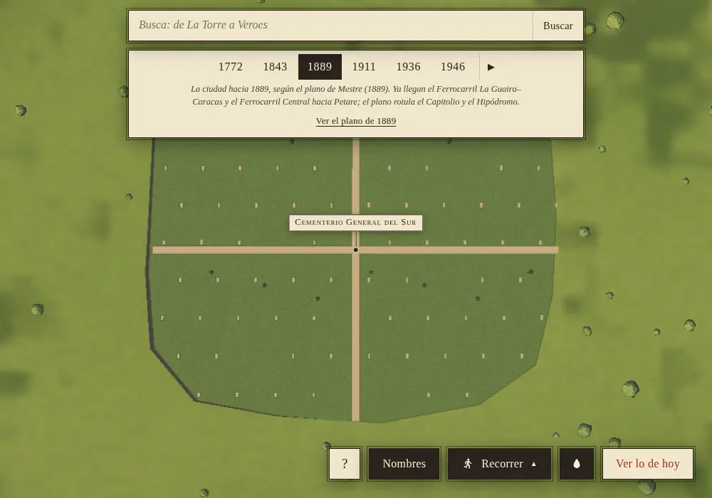
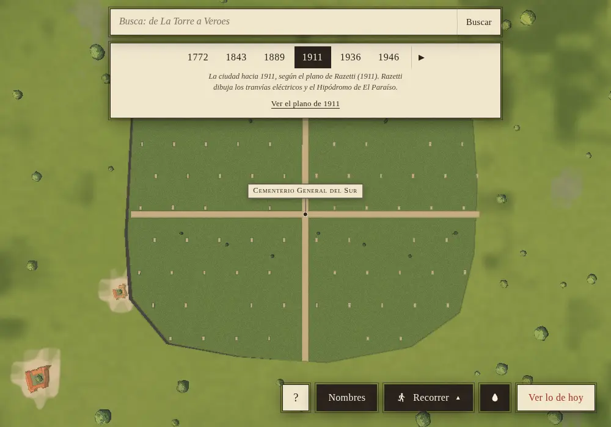

# Integración del Cementerio General del Sur

Issue relacionado: [#250](https://github.com/grunch/caracas/issues/250). Este cambio implementa el General del Sur. Hijos de Dios fue integrado en #287 y no se vuelve a modificar. El issue #250 permanece abierto hasta revisar ambos recintos y el alcance completo.

## Evidencia por fase

- **1889 y 1911:** el cementerio existe desde 1876. Los mapas urbanos consultados no cubren el sitio con detalle medible. Rodríguez describe cuatro cuarteles y dos avenidas de cuatro metros, pero no da una localización precisa ni ejes para este núcleo. Se cruzan dos vías esquemáticas para sugerir la división en cuatro; el contorno, la posición y la orientación son interpretativos.
- **1936:** el plano DCN dibuja el campo funerario al sur de la ciudad, con bordes adaptados al relieve, calles internas, arbolado y crecimiento irregular. `CONTORNO_SUR_1936` y `CALLES_SUR_1936` son una digitalización aproximada de esa hoja, no un deslinde catastral.
- **1946:** el plano DCN localizado en Princeton está restringido y no se descargó. Se conserva el trazado de 1936 como referencia visual provisional y se indica expresamente que no es un calco de 1946.
- Las sepulturas, panteones genéricos y árboles no representan un inventario ni se atribuyen a familias concretas. No se modela una portada monumental sin alzado histórico demostrado.
- El césped del recinto usa un patrón plano propio; no hereda los canteros en cruz y X de las plazas. Las vías se recortan en el contorno irregular para no prolongarlas sobre las laderas.

## Archivos y comportamiento

- `src/hitos/datos/cementerio-sur.js`: ancla, dos huellas temporales y fuente cartográfica.
- `src/hitos/cementerio-sur.js`: geometría simplificada de los campos, caminos, sepulturas y árboles.
- `src/hitos/material.js`: tratamiento de césped verde liso para el recinto, aparte del patrón formal de plazas.
- `src/hitos/partes.js` y `src/hitos.js`: registra el constructor y su vida desde la época 1889.
- `src/hitos/plantas.js`: las colisiones distinguen el núcleo 1889/1911 de la ampliación representada en 1936/1946.
- `src/hitos/suprimir.js`, `src/hitos/suprimir-arboles.js` y `src/hitos/suelos-propios.js`: las reservas de casas, árboles y suelo cambian con las dos fases. Los tipos antiguos de huella siguen funcionando sin cambios.
- `src/fichas-datos.js`: explica la incertidumbre y la diferencia entre compra de terrenos y extensión desarrollada.

El ancla conservada en el catálogo es `(7100, 12500)` en píxeles del mapa base. Cada metro del modelo corresponde a dos píxeles; el eje principal sigue el eje horizontal de DCN1936. No se cambian calles ni se crean épocas. La geometría del hito se genera en el trabajador y las reservas por fase comparten los formatos ya usados por los demás hitos.

## Pruebas y revisión

El test `tests/unit/cementerio-sur.test.js` comprueba las dos fases, el recorte de calles contra un polígono cóncavo, las reservas de casas/árboles/suelo, colisiones, geometría finita y cronología. También se amplió la validación general de hitos para aceptar áreas con vida propia por etapa, sin cambiar el formato de las geometrías existentes. No se agregan binarios ni texturas descargadas al repositorio.

Antes de instalar, generar capturas del visor en 1889, 1911, 1936 y 1946 y comprobar: ausencia antes de 1889; núcleo reducido para 1889/1911; contorno DCN aproximado desde 1936; continuidad explícitamente provisional en 1946; reservas sin casas ni árboles dentro del cementerio; y ausencia de errores de shader. Medir el incremento de geometría y el arranque del sitio contra `main`; no subir presupuestos sin justificarlo.

## Fuentes

- Cámara de Caracas, [transcripción de Landaeta Rosales sobre el origen del cementerio, 1875–1904](https://camaradecaracas.com/la-camara-caracas-y-sus-historias/ocurrio-aqui/origenes-del-cementero-general-del-sur-en-caracas-1875-1904/). Distingue inauguración y primeros entierros, propiedad inicial, compra de 1889 y obras posteriores. El original de 1906 todavía no se ha cotejado directamente.
- Yuleima Rodríguez (2011), [“Cementerio General del Sur: aproximación histórica…”](https://servicio.bc.uc.edu.ve/postgrado/manongo36/art07.pdf), *Revista Mañongo* 36, pp. 173–198; cuatro cuarteles y dos avenidas de 4 m, arbolado, expansión por secciones y cartograma 1876–1940.
- Dirección de Cartografía Nacional, [Plano de Caracas de 1936](https://archive.org/details/WCWdb_18053), cotejado en el mosaico del proyecto.
- Princeton University Library, [Plano de Caracas catalogado para 1946](https://maps.princeton.edu/catalog/princeton-4j03d351f), con acceso restringido. Se usó la ficha catalográfica; no se atribuye a ese ejemplar una lectura visual.

## Capturas de comprobación

Vistas capturadas en el visor; las cuatro se incluyen en formato WebP para mantener pequeño el cambio.

| 1889 | 1911 |
| --- | --- |
|  |  |

| 1936 | 1946 |
| --- | --- |
|  |  |

La vista de 1946 muestra explícitamente la reutilización provisional de 1936; ninguna captura se presenta como un calco de 1946.

Las referencias fotográficas de arquitectura no se redistribuyen. La localización 1889/1911 queda abierta: no se inventa un perímetro a partir de la parcela comprada ni se usa el mapa de 1936 para fechar la expansión.
