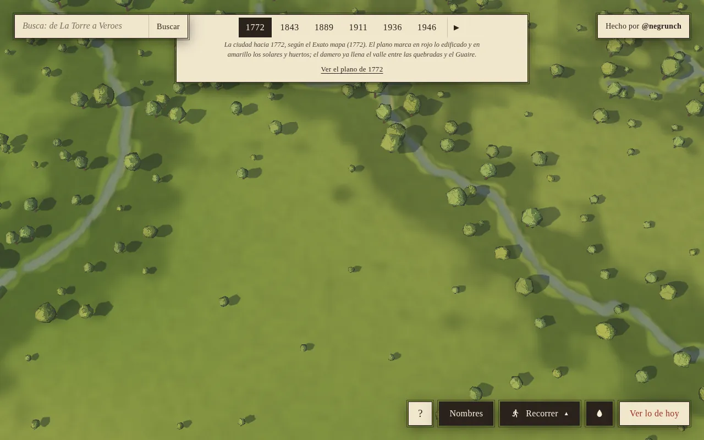
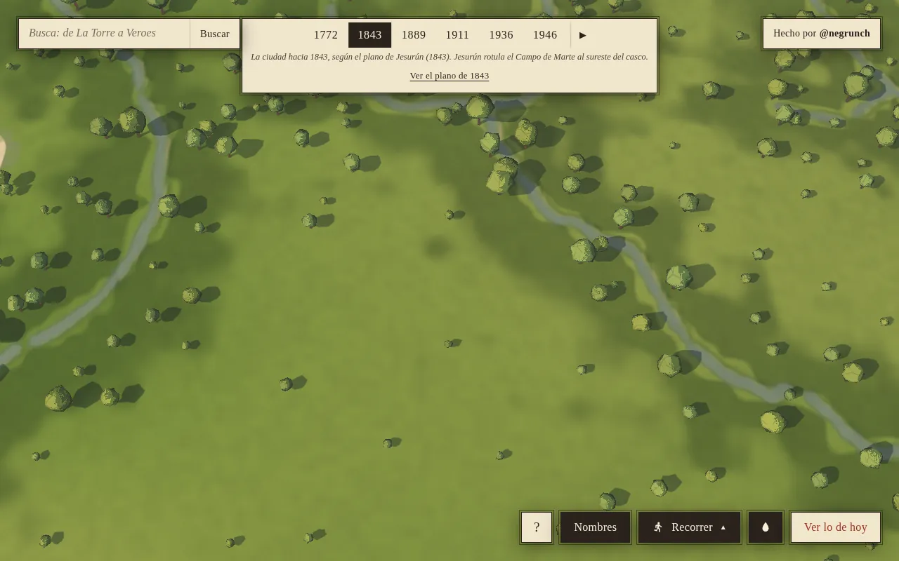
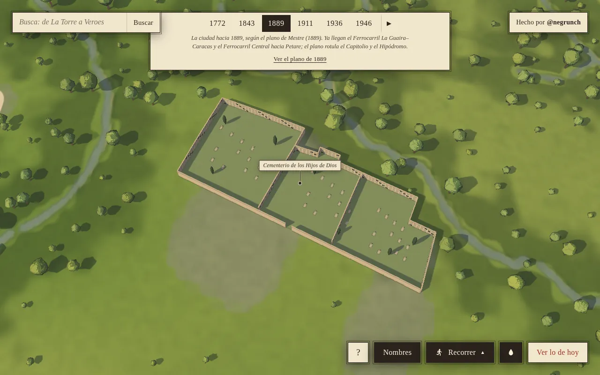
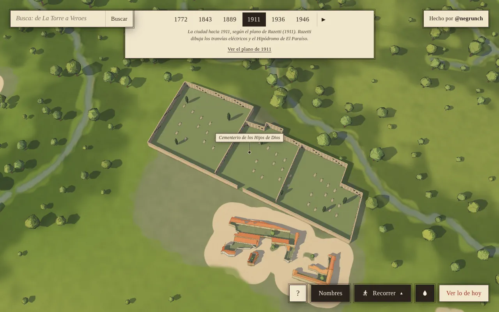
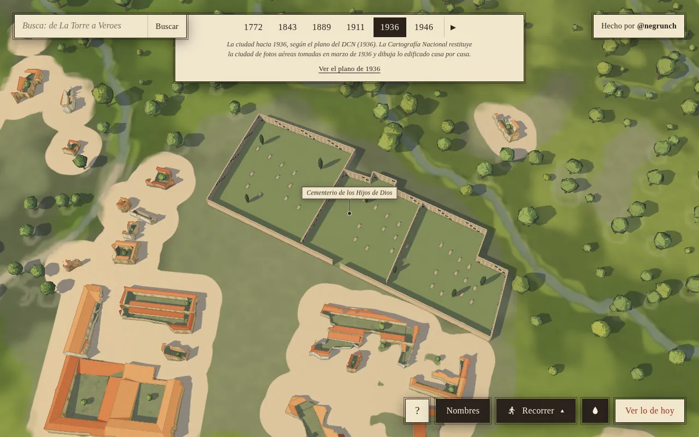
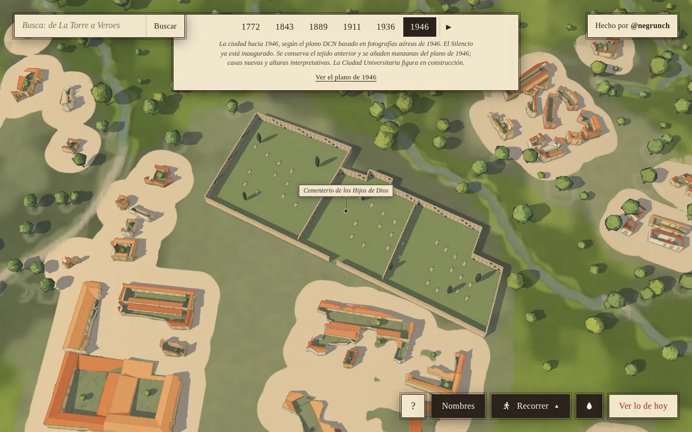

# Cementerio de los Hijos de Dios: integración del estudio Miraflores

Parte de #250. Integrado por el [PR #287](https://github.com/grunch/caracas/pull/287) (fusionado el 27-11-2026); el Cementerio General del Sur, por el #288 ([guía](cementerio-sur-integracion.md)). Main 0c99f37 tenía marca y ficha (PR 234 y cronología 280), sin modelo en HITOS. No se repite esa corrección ni se toca Trinidad. El 28-11-2026 se añadieron el [registro por imagen](#referencias-visuales-imagen-por-imagen), lo que se sabe del [abandono](#abandono-y-uso) y las capturas de las seis épocas en el repo.

## Evidencia

[Contexturas](https://contexturas.org/el-cementerio-de-los-hijos-de-dios/) reproduce fotografías y pinturas con muros de nichos superpuestos. La fotografía Boulton1934 se identifica con copyright de Alberto Vollmer Foundation: solo consulta local. [FAC](https://fundaayc.com/2018/02/09/1951-desaparece-el-cementerio-de-los-hijos-de-dios/) documenta apertura1856, clausura anterior a1889 y demolición1951. La marca existente ya recoge esta vida.

[Digitalización aproximada](hijos-dios-georreferencia.json): tres campos contiguos y entrante noreste en DCN1936, cotejados con el plano de fotos1946. Razetti1889 muestra tres recintos, con proporciones distintas; no se deduce reforma ni traslado de esa diferencia cartográfica. Se conserva la geometría aproximada1936 en las cuatro épocas1889–1946, explicitando el límite. No hay presencia1772/1843.

## Estudio e instalación

Corregido primero en Miraflores: constructor independiente, sin capilla no documentada, cuatro hileras de nichos, sepulturas dispersas y cipreses. Copia explícita en `src/hitos/hijos-dios-constructor.js`, factoría ciudad y adaptador al lienzo común. Sin GLB ni texturas descargadas en ejecución. La geometría se agrupa por material y se libera tras copiarla.

Origen8620,3670, eje paralelo al frente del dibujo, suelo verde convencional. El recinto sigue la ladera por vértice, sin terraza horizontal rectangular. Las caras extensas se subdividen a4m para evitar intersecciones entre muestras de relieve. No se trata de un levantamiento de los niveles históricos. La malla gruesa del terreno (96m sin GPU) podía atravesar el pavimento fino: el shader oculta exclusivamente su interior poligonal, con margen0,4m, vida3→0 y solo tras completarse la ola de levantamiento. Al acostar la ciudad o volver a1772/1843, vuelve el suelo original. Huella poligonal completa para supresión temporal de casas/árboles; colisión solo sobre muros, sin convertir los campos abiertos en cajas sólidas. Entrada sur interpretativa4m; sin portal situado arbitrariamente a partir de una fotografía. Registro al final de las listas para preservar semillas.

Dimensiones nominales de altura5,5m, espesor0,65m, nichos, sepulturas y vegetación son interpretativas, no levantamiento. Envolvente170×68m aproximada. No se atribuyen nombres a tumbas ni se inventan cambios de abandono por fecha.

## Validación

Las pruebas específicas verifican vida3→0, recinto que excluye calle/seminario/entrante, enlace de marca, apoyo del relieve por vértice y subdivisión que conserva el área con caras de suelo de hasta4m. En Miraflores22 pruebas pasan; perspectiva/planta cotejadas con1936/1946, sin errores de navegador. Las capturas urbanas comparables de las seis épocas y la comparación de rendimiento están en los artefactos enlazados abajo. Esta integración no cambia datos cartográficos ni requiere regenerar el paquete.

Validación tras rebasar sobre main d99e17d (incluye San Agustín): npm test -- --maxWorkers=2, 1.848 pruebas en139 archivos; build y node tools/rendimiento/presupuesto-build.mjs pasan; E2E 1889–1946 pasa sin errores de shader. La geometría aislada del recinto suma17.284triángulos; total histórico592.022 y todas las fases1.071.395. Topes explícitos de hitos600.000/1.080.000. Build combinado343,2kB inicial y162,7kB workers gzip; límites344/163, sin elevar presupuestos de ejecución. Las mediciones emparejadas y sus límites constan en [mediciones de rendimiento](mediciones/hijos-dios/README.md).

### Reglas de construcción aplicables y límites de auditoría

Se revisaron las reglas T82 de `specs/13-reglas-de-construccion.md` para no presentar las pruebas locales como una auditoría completa del mapa:

| Regla | Estado en este cambio |
|---|---|
| R1, R3–R8 | No aplican al cementerio: la geometría no genera casas, frentes de manzana, patios domésticos ni suelo residencial. Esto no certifica esas reglas para las otras geometrías del mapa. |
| R2 · Calles libres | Parcial: una prueba unitaria comprueba que la huella no cubre puntos de referencia de la calle y el seminario. No se midieron todas las caras frente a la calzada ni se ejecutó `reglas_mapa.py` para certificar calles de la ciudad. |
| R9 · Cada nombre en su lugar | Parcial: prueba unitaria comprueba que la marca enlaza al hito en vez de conservar una coordenada aislada. No prueba distancia de la etiqueta a la geometría ni es un catastro. |
| R10 · Agua continua | No se altera la red hidrográfica; la continuidad de cauces no se volvió a medir en este PR. |
| R11 · Sin anacronismos | Verificada en pruebas unitarias: ausente en 1772/1843, presente desde 1889 en las cuatro épocas siguientes, de acuerdo con la vida ya documentada de la marca. No se proponen cambios arquitectónicos por época sin evidencia. |
| R12 · Las otras épocas intactas | Comparación pixel a pixel de las vistas 1772/1843 antes/después sin diferencias; la prueba unitaria verifica la vida 1889–1946 y el E2E renderiza las cuatro épocas con el hito. No equivale a correr todas las puertas `reglas_mapa.py --todas` ni prueba por sí sola la visibilidad por píxeles. |

Las mediciones globales de antes/después R1–R12 no están disponibles para ninguna de las seis épocas visibles (1772, 1843, 1889, 1911, 1936 y 1946): `tools/geo/reglas_mapa.py` sigue pendiente de F1 en `specs/13-reglas-de-construccion.md` y no existe en esta base. Por eso no hay resultados completos por época y regla. La tabla separa los chequeos locales que sí se hicieron de los que siguen sin verificar. Las capturas y la comparación de rendimiento no se presentan como mediciones de R1–R12.

Capturas comparables de seis épocas antes/después: [gist secreto](https://gist.github.com/grunch/83d11c415ad724a4ea3ae720a0dffaec). La sesión actual no tiene un navegador interactivo conectado; la revisión visual automatizada y el E2E sí se corrieron, pero no se afirma una prueba manual.

Las seis épocas con la misma cámara (centro 8620,3670 px, 380 m de distancia; `main` con los datos regenerados con
R13, 28-11-2026) están también en el repo, en [`capturas/cementerios-250/`](capturas/cementerios-250/): en 1772 y
1843 no hay cementerio.

| 1772 | 1843 | 1889 |
| --- | --- | --- |
|  |  |  |

| 1911 | 1936 | 1946 |
| --- | --- | --- |
|  |  |  |

## Referencias visuales, imagen por imagen

Créditos tal como los da [Contexturas, «El Cementerio de los hijos de Dios»](https://contexturas.org/el-cementerio-de-los-hijos-de-dios/)
(Manuel Pulido Azpúrua, 2020; página leída el 28-11-2026). La página trae ocho imágenes sin pie individual y una
lista de créditos al final, en este orden; la correspondencia de cada crédito con cada imagen es la de esa lista y
no se verificó de otro modo. Ninguna entró a `fuentes/imagenes/` ni al paquete de fotos.

| Crédito en Contexturas | Fecha | Autor o procedencia | Licencia | Uso acá |
|---|---|---|---|---|
| Imagen de portada: vista del cementerio | No establecida | Autor desconocido | No establecida | Consulta |
| «El Cementerio de los Hijos de Dios» | 1934 | Alfredo Boulton; Archivo Fotografía Urbana / Alberto Vollmer Foundation | Con derechos (colección privada): solo consulta | Muros de nichos superpuestos; no se redistribuye |
| Diversas vistas del cementerio | No establecida | Autores desconocidos | No establecida | Nichos en los muros; no fechan nada |
| «El Ávila visto desde el Cementerio de los hijos de Dios» (pintura) | 1918 | Manuel Cabré; Colección FMN-GAN | No establecida | Ninguno: una pintura no es un levantamiento |
| «Amanecer en el Cementerio de los hijos de Dios» (pintura) | 1919 | Nicolás Ferdinandov; Colección FMN-GAN | No establecida | Ninguno |
| Construcción del Conjunto Residencial 2 de Diciembre; autopista (1960); bloques Los Hijos de Dios | Posteriores a la demolición | Autores desconocidos | No establecida | Ninguno: son posteriores a 1946 |

No se usó ninguna fotografía actual, ni las de los bloques que hoy ocupan el sitio, como prueba del recinto.

## Abandono y uso

El issue pide distinguir el abandono del uso activo. Lo que hay:

- [FAC](https://fundaayc.com/2018/02/09/1951-desaparece-el-cementerio-de-los-hijos-de-dios/): abierto en 1856, clausurado antes de 1889, demolido en 1951.
- Contexturas (2020) lo describe «hermoso y apacible, pero en ruinas» cuando lo pintaban y fotografiaban a fines
  del siglo XIX y comienzos del XX, y recoge un recuerdo familiar de «tumbas profanadas y en mal estado» en los años
  cuarenta. Es un texto de divulgación de 2020, sin documento de época para cada afirmación.

Con eso el visor dice en el rótulo y en la ficha que el recinto está **clausurado y todavía en pie** en las cuatro
épocas (1889 a 1946), y no cambia la geometría: ninguna fuente fecha un derrumbe, una reforma ni el estado de los
muros en un año dado. No se dibujan ruinas ni tumbas rotas «por fecha». **Falta** una fotografía o un documento
con fecha que muestre el estado de los muros y nichos en 1889, 1911, 1936 o 1946 para representar el deterioro.
