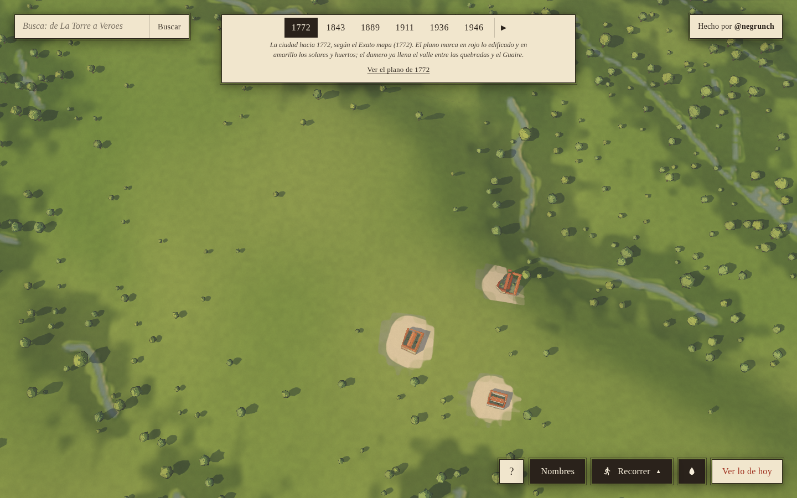
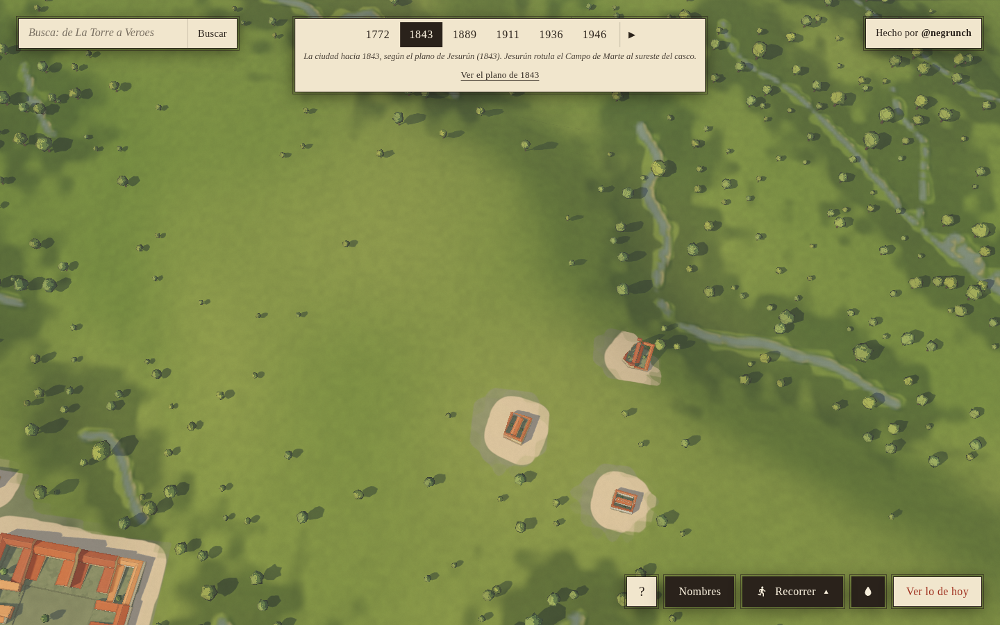
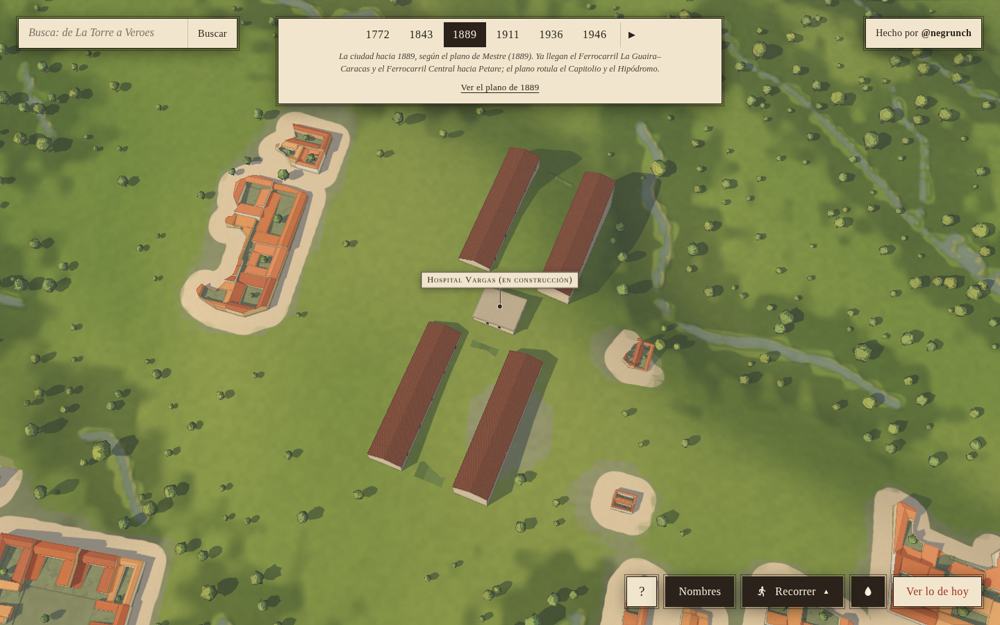
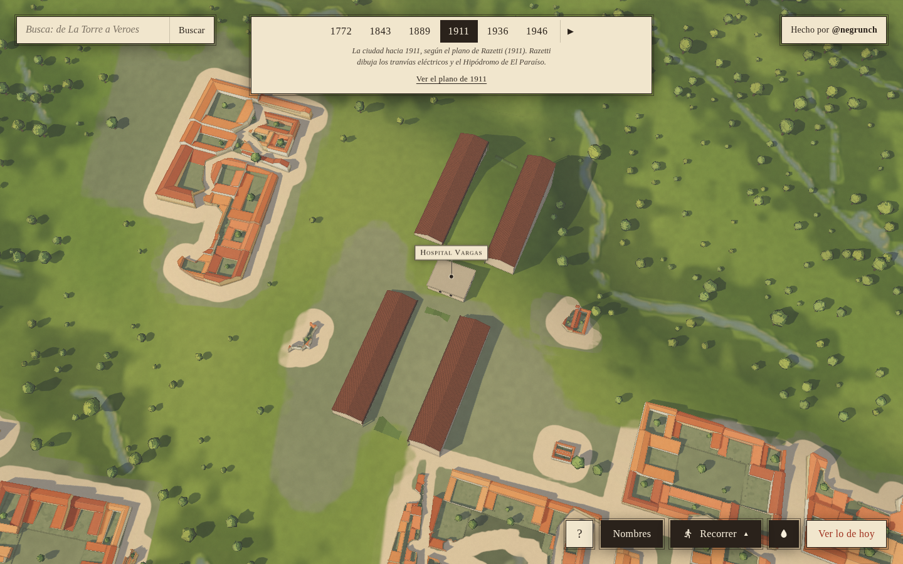
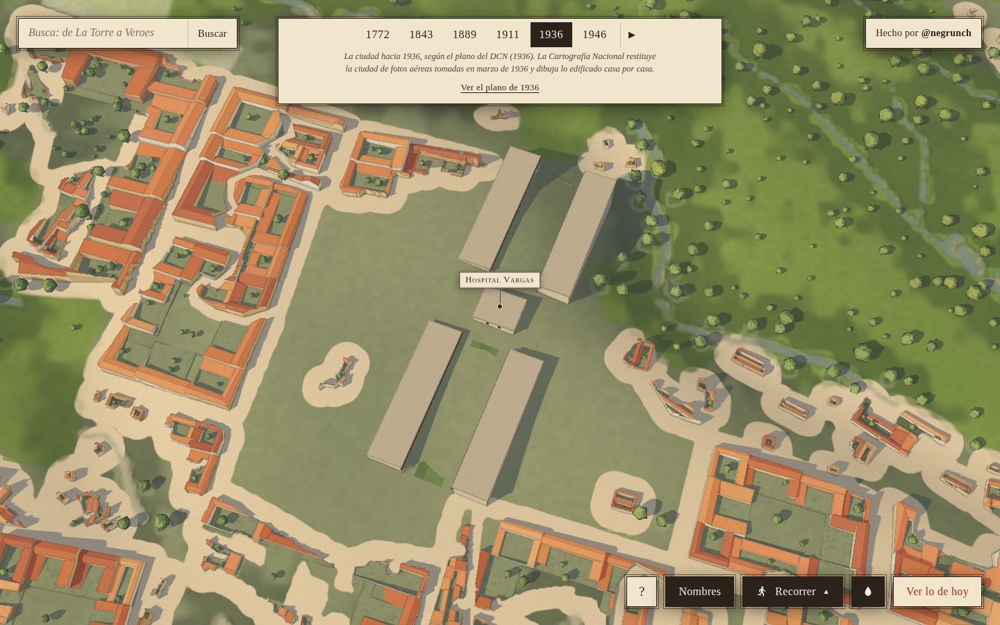
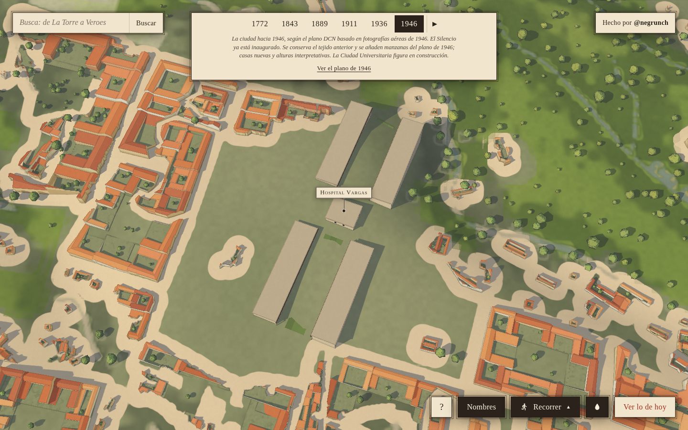

# Hospital Vargas — issue #249

**Estado:** modelo instalado por el [PR #289](https://github.com/grunch/caracas/pull/289) (fusionado el 27-11-2026). El 28-11-2026 se corrigieron los vanos del núcleo, se enlazó la marca al hito, se completó la ficha de 1936 y 1946 y se añadieron las capturas de 1772 y 1843. El issue permanece abierto: ver [Qué falta](#qué-falta).

## Evidencia y fechas

- El [plano de Vicente S. Mestre de 1889](https://commons.wikimedia.org/wiki/File:Plano_topografico_de_la_ciudad_de_Caracas,_levantado_en_1889_vajo_la_direccion_-_del_general_don_Vicente_S._Mestre_-_btv1b53027837n.jpg), n.º 43, muestra dos alas de pabellones, un núcleo central y galerías longitudinales. El calce local de 1889 a 1936 usa 479 puntos de control y reporta RMS LOO de 7,64 m.
- La [Guía de Caracas](https://guiaccs.com/obras/hospital-vargas/) describe un edificio de una planta, eje norte-sur, acceso oeste, alas de hombres y mujeres y cinco salas por fila separadas por jardines.
- Roger Escalona, [Sociedad Venezolana de Historia de la Medicina](https://revista.svhm.org.ve/ediciones/2006/1-2/art-3), distingue la inauguración del 1 de enero de 1891 de la admisión de pacientes desde julio. Por eso la marca ya existente continúa indicando «en construcción» para 1889 y el hito no aparece en épocas anteriores.
- El grabado del [Cojo Ilustrado de 1-1-1892](https://www.libroria.com/museo/obras/El%20Cojo%20Ilustrado/1892/pdf/CI_18920101.pdf), p. 12, documenta una galería hospitalaria interior; no es una elevación completa de la fachada.
- [Caracas en 450](https://banesco-prod-2019.s3.amazonaws.com/wp-content/uploads/Caracas-en-450.pdf) resume la sustitución, desde 1930, de techos ojivales de madera por platabandas. El modelo cambia a cubierta plana en 1936 y la conserva en 1946.

Las ampliaciones de los pabellones Carlos J. Bello, Ángel Larralde y de lactantes se fechan en 1939 en una fuente médica de 1953, pero no se ha encontrado una planta que los sitúe inequívocamente. No se añadieron como volúmenes geolocalizados. Las fotografías y el grabado se enlazan como referencia; no se descargaron ni redistribuyeron. La licencia de la imagen de 1892 no está verificada.

## Evidencia por etapa

| Fecha del hecho | Documento (fecha del documento) | Qué permite representar | Qué no demuestra | Certeza |
|---|---|---|---|---|
| 1885 y 1888 | Escalona, SVHM (2006) | Decreto y comienzo de las obras: nada antes de 1889 | El avance de la obra en una fecha dada | Secundaria |
| 1889 | Plano de Mestre (1889), n.º 43 | Emplazamiento y planta: dos filas de pabellones, núcleo y galerías | Que los pabellones estuvieran terminados o techados: el hospital no se había inaugurado | Primaria (cartográfica); calce RMS «dejando uno fuera» de 7,64 m |
| 1-01-1891 y 5-07-1891 | Escalona, SVHM (2006) | Inauguración y primeros pacientes: «Hospital Vargas», sin «en construcción», desde la época de 1911 | Cambios de la planta entre 1889 y 1911 | Secundaria |
| 1892 | Grabado de *El Cojo Ilustrado*, 1-01-1892, p. 12 | Una galería interior | La fachada completa; licencia de la reproducción no verificada | Primaria, parcial |
| Desde 1930 | *Caracas en 450* (releído el 28-11-2026): «Desde 1930 la estructura original […] ha sufrido cambios importantes: los techos de madera –ojivales– fueron sustituidos por platabandas»; remite a Chacín Álvarez, *Cien años del Hospital Vargas (1891-1991)*, que no se consultó | Cubierta plana en las épocas posteriores a 1930 | El año de cada pabellón, ni que en 1936 ya estuvieran cambiadas: ponerlas planas desde 1936 es una interpretación | Secundaria |
| 1939 | «Reporte médico de 1953», citado por el estudio de Miraflores sin referencia completa | Nada: nombra tres pabellones nuevos (Carlos J. Bello, Ángel Larralde y de lactantes) | Dónde estaban ni qué forma tenían | Secundaria, sin referencia localizable |

**Contradicción pendiente.** El issue pide no inventar pabellones terminados en 1889. El visor levanta en 1889 las
cuatro filas de salas con su tejado, igual que en 1911 salvo las galerías, mientras el rótulo y la ficha dicen «en
construcción». El estudio de Miraflores los deja sin cubierta ni galerías (`enObra`). Ninguna fuente dice qué había
levantado en 1889, así que cualquiera de las dos representaciones es una convención. No se cambió acá: es una
decisión del responsable, con las capturas de 1889 a la vista.

## Integración en Caracas

- `src/hitos/datos/hospital-vargas.js` define la huella (100 × 270 m nominales) en el sistema de píxeles de 1936, centrada aproximadamente en (9796, 4503). La ubicación se derivó de la planta de Mestre y del TPS existente. Estas dimensiones son interpretativas, no catastrales.
- `src/hitos/hospital-vargas.js` construye los pabellones en la malla común. Las filas, vanos y galerías simplifican las fuentes; el esquema de 1889 representa la planta que el plano dibuja, no afirma que toda la construcción estuviera terminada.
- `src/hitos/datos/civiles.js` y `src/hitos/partes.js` enlazan el hito con el render, el tiempo y la marca existente `hospital-vargas`; no duplican su ficha ni su cronología.
- La reserva del solar suprime las casas genéricas y árboles dentro del recinto desde 1889, manteniendo intactas las manzanas exteriores. La colisión peatonal se limita a los cuatro pabellones y al núcleo; jardines y corredores quedan transitables.
- `tests/unit/hospital-vargas.test.js` verifica registro único, fases, aparición desde 1889, reservas y geometría finita. `tests/unit/hitos.test.js` incluye el suelo del pabellón en la verificación de apoyos sobre el relieve.
- El conjunto añade 4.800 vértices (2.376 triángulos; ~0,43 MB de atributos CPU), integrado en la malla de hitos compartida.

El hito reconstruye el núcleo y las cuatro filas de salas legibles en 1889. Los edificios que aparecen alrededor en los mapas posteriores siguen como unidades del plano; no se declaran ampliaciones hospitalarias sin una identificación documental del predio.

## Capturas

Las capturas comparables de las seis épocas están en [`docs/capturas/hospital-vargas/`](capturas/hospital-vargas/), con la misma cámara (`tests/e2e/capturas-hospital-vargas.mjs`) y los datos regenerados con R13 (28-11-2026). En 1772 y 1843 no hay hospital; de 1889 a 1946 se ve la planta de pabellones, con cubierta plana en 1936 y 1946. `perspectiva-1911.png` muestra las galerías, las fachadas y los vanos del núcleo desde un ángulo bajo; `antes-perspectiva-1911.png` es la misma vista en `main`, con el núcleo ciego.

| 1772 | 1843 | 1889 |
| --- | --- | --- |
|  |  |  |

| 1911 | 1936 | 1946 |
| --- | --- | --- |
|  |  |  |

## Marca y reglas de construcción

- **R9, cada nombre en su lugar.** La marca tenía una coordenada suelta, (9660, 4640), a unos 96 m del centro del
  hito: caía en el borde suroeste del solar, sobre el jardín. Ahora va enlazada (`hito: 'hospital-vargas'`) y toma
  la posición del hito, (9796, 4503), sobre el núcleo.
- **R13, ningún hito sobre una manzana.** Medido en `main` por #291 ([`manzanas-hitos.md`](manzanas-hitos.md)): el
  recinto (27.000 m²) es mayor que las manzanas que pisa, que se retiran enteras de 1889 a 1946. Este cambio no
  toca la huella ni la reserva, así que la tabla no cambia.
- **R11, sin anacronismos.** El E2E comprueba que ningún vértice del hospital nace antes de 1889.
- R1 a R12 con `tools/geo/reglas_mapa.py`: no se pudieron medir, la herramienta no existe todavía (F1 de `specs/13`).

## Qué falta

1. **Los anexos de 1939.** Falta una planta del hospital de 1939 a 1953, o una foto aérea rotulada, que ubique los
   tres pabellones; y falta identificar el «reporte médico de 1953» (el estudio lo cita sin autor, título ni
   enlace). Comparar el recorte [9000,4000,10200,5100] entre los planos de 1936 y 1946 mostraría volúmenes nuevos,
   pero no les pondría nombre.
2. **1889 en obras.** Decidir si los pabellones van sin cubierta (ver la contradicción de arriba).
3. **Prueba a mano de una persona** de las seis épocas.
4. **Datos.** Regenerar y publicar los datos después de los cambios de hitos (`npm run datos:al-dia` avisa).

## Límites

La planta general deriva del plano de 1889, pero alturas, espesores, materiales, medidas de cada pabellón y diseño de fachada son esquemáticos. La fuente médica de 1953 y las fotografías posteriores no bastan para geolocalizar las ampliaciones de 1939 ni para asignarles una forma individual. El issue #249 no se cierra por esta integración parcial.
