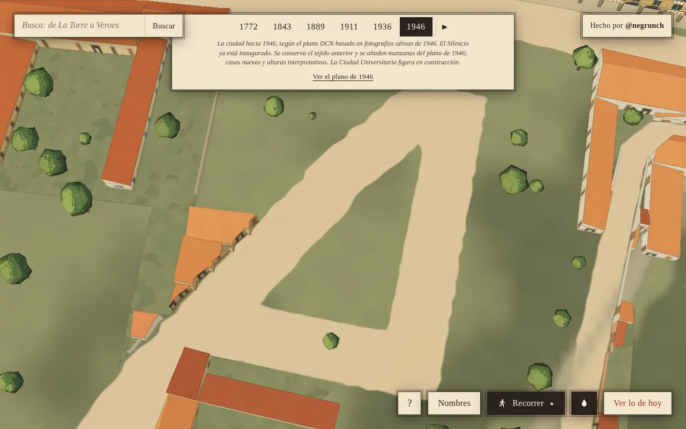
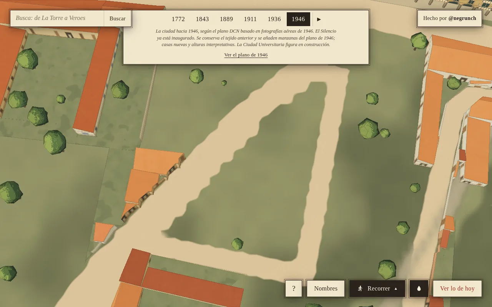
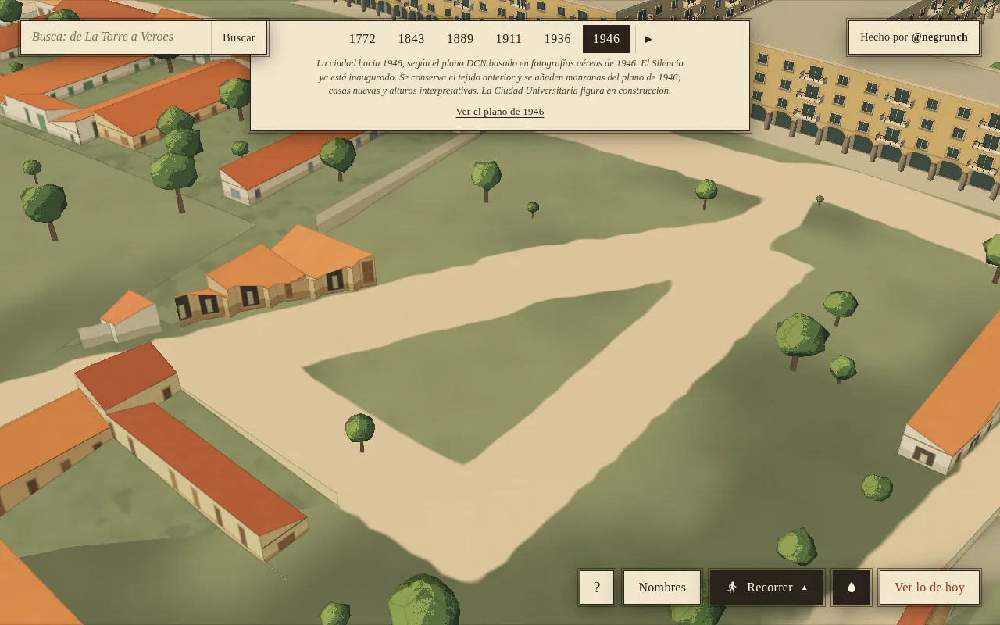
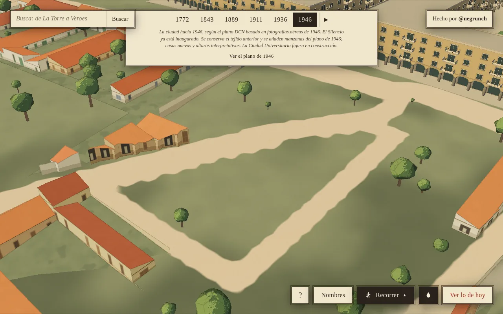
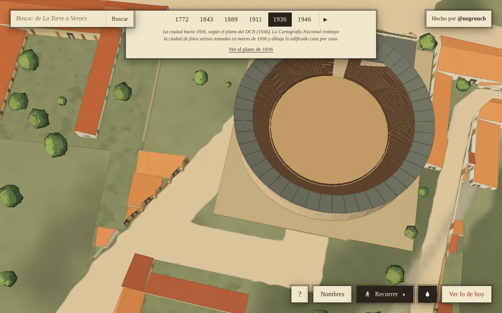

# Hitos y manzanas: ningún hito sobre una manzana (R13)

Regla del responsable (27-11-2026): «No pongas el hospital ni ningún edificio sobre la manzana; si es un edificio
pequeño puedes agregarlo dentro de la manzana, pero si es grande hay que quitar la manzana.» Es la R13 de
[`specs/13`](../specs/13-reglas-de-construccion.md).

La medida y la decisión son de `tools/geo/hitos_manzanas.py`; los pasos `retiro-<año>` la aplican a las manzanas
heredadas y a las nuevas de cada época. `node tools/hitos-manzanas-tabla.mjs` vuelve a escribir la tabla completa
([`manzanas-hitos.json`](manzanas-hitos.json): una fila por hito, época y manzana que se cruzan, con las áreas y
las fracciones en los dos sentidos) desde los informes de `fuentes/derivados/retiro<año>/`.

## Qué se mide

Por cada hito de `hitosConPlanta()` en pie en la época y cada manzana que comparte al menos 1 m² con su recinto:

- **huella**: la unión de sus plantas (lo edificado); **recinto**: la huella más su zona de supresión (lo que reserva);
- **manzana bajo el recinto** (y bajo la huella): qué fracción de la manzana cubre;
- **recinto en la manzana** (y huella en la manzana): qué fracción del hito cae en esa manzana;
- **ocupación**: la fracción de la manzana bajo los recintos de **todos** los hitos en pie.

## El criterio

Una manzana se **retira entera** en la época (casas, árboles y suelo de manzana) si:

1. la ocupación es **≥ 50 %** (los hitos ocupan la mayor parte), o
2. la pisa en **≥ 10 %** un hito cuyo recinto es **mayor que la manzana** (no puede estar «dentro» de ella: la abarca).

Si no, se conserva, y el cruce queda en una de tres clases: **chico** (≥ 75 % del recinto cae en la manzana: el
hito va dentro, sin casas ni árboles encima, como hasta ahora), **roce** (menos de 10 % de la manzana y del hito:
no se distingue del error de calce) o **a caballo** (ni cabe ni manda: límite declarado abajo).

Por qué esos umbrales, con los datos:

- **50 %.** Entre las manzanas que se conservan, la ocupación más alta es 41 % (Plaza La Concordia),
  40 % (Universidad con San Francisco) y 35 % (Catedral con el Palacio Arzobispal); entre las que se retiran por
  ocupación, la más baja es 51 %. No hay ningún caso entre 41 % y 51 %: cualquier umbral en ese hueco da lo mismo.
  Bajarlo a un tercio se llevaría la manzana de la Catedral.
- **10 %** para el hito mayor que la manzana. El Hospital Vargas (recinto de 27.000 m²) declara un calce de 7,6 m
  RMS: en una cuadra de 100 m, una franja de ese ancho es un 8 %. Los cruces de un hito mayor que la manzana que se
  conservan llegan a 3 %; los que se retiran empiezan en 13 %. Tampoco hay casos en el hueco.
- **75 %** solo separa «chico» de «a caballo» (no decide retiros): los chicos empiezan en 77 % y los que quedan a
  caballo no pasan de 41 %.

Una manzana retirada deja de heredarse, y mientras el hito siga en pie su suelo cuenta como ocupado: el plano de las
épocas siguientes no levanta otra manzana encima (si no, la cuadra del hito volvería con otro nombre y con casas
pegadas a él). Cuando el hito ya no está en pie y ningún otro la retira, **la manzana vuelve** en esa época
([abajo](#cuando-el-hito-ya-no-está-la-manzana-vuelve)).

## Qué se retira, por época y por hito

**1772** — quedan 252 manzanas, se retiran 1:

- capitolio: `U1772-0203` (16.615 m², 96 %)

**1843** — quedan 398 manzanas, se retiran 1:

- capitolio: `U1772-0203` (16.615 m², 96 %)

**1889** — quedan 484 manzanas, se retiran 2:

- hospital-vargas: `V1772-38689-0-0` (213 m², 100 %)
- capitolio: `U1772-0203` (16.615 m², 96 %)

**1911** — quedan 876 manzanas, se retiran 9:

- hospital-vargas: `V1772-38689-0-0` (213 m², 100 %), `M4-0042-A0` (95 m², 13 %), `M4-0044-A0` (7.069 m², 19 %)
- capitolio: `U1772-0203` (16.615 m², 96 %)
- circo-metropolitano: `U1843-0224-A0` (1.365 m², 51 %)
- hijos-de-dios: `M4-0005-A0` (238 m², 81 %), `M4-0006-A0` (42 m², 75 %), `M4-0007-A0` (188 m², 78 %)
- cementerio-sur: `M4-0542-A0` (136 m², 100 %)

**1936** — quedan 7053 manzanas, se retiran 27:

- hospital-vargas: `V1772-38689-0-0` (213 m², 100 %), `M4-0042-A0` (95 m², 13 %), `M4-0044-A0` (7.069 m², 19 %), `M5-0887-A0` (5.926 m², 21 %), `M5-1015-A0` (41 m², 100 %), `M5-1046-A0` (151 m², 22 %), `M5-1048-A0` (45 m², 100 %), `M5-1064-A0` (82 m², 100 %), `M5-1088-A0` (15.006 m², 35 %), `M5-1107-A0` (1.169 m², 82 %), `M5-1225-A0` (1.100 m², 100 %)
- capitolio: `U1772-0203` (16.615 m², 96 %)
- circo-metropolitano: `U1843-0224-A0` (1.365 m², 51 %)
- hijos-de-dios: `M4-0005-A0` (238 m², 81 %), `M4-0006-A0` (42 m², 75 %), `M4-0007-A0` (188 m², 78 %), `M5-0571-A0` (190 m², 98 %), `M5-0586-A0` (2.431 m², 100 %), `M5-0642-A0` (81 m², 100 %)
- cementerio-sur: `M4-0542-A0` (136 m², 100 %), `M4-0552-A0` (45 m², 100 %), `M4-0560-A0` (123 m², 100 %), `M5-7418-A0` (71 m², 100 %), `M5-7518-A0` (275 m², 100 %)
- nuevo-circo: `M4-0376-A0` (9.101 m², 64 %)
- panteon: `M5-1834-A0` (626 m², 91 %)
- plaza-bolivar: `M5-3554-A0` (505 m², 100 %)

**1946** — quedan 10665 manzanas, se retiran 47 y vuelve 1 (`U1843-0224-A0`, 1.365 m², la que el Circo
Metropolitano retiró en 1911 y 1936):

- hospital-vargas: `V1772-38689-0-0` (213 m², 100 %), `M4-0042-A0` (95 m², 13 %), `M4-0044-A0` (7.069 m², 19 %), `M5-0887-A0` (5.926 m², 21 %), `M5-1015-A0` (41 m², 100 %), `M5-1046-A0` (151 m², 22 %), `M5-1048-A0` (45 m², 100 %), `M5-1064-A0` (82 m², 100 %), `M5-1088-A0` (15.006 m², 35 %), `M5-1107-A0` (1.169 m², 82 %), `M5-1225-A0` (1.100 m², 100 %)
- capitolio: `U1772-0203` (16.615 m², 96 %)
- hijos-de-dios: `M4-0005-A0` (238 m², 81 %), `M4-0006-A0` (42 m², 75 %), `M4-0007-A0` (188 m², 78 %), `M5-0571-A0` (190 m², 98 %), `M5-0586-A0` (2.431 m², 100 %), `M5-0642-A0` (81 m², 100 %)
- cementerio-sur: `M4-0542-A0` (136 m², 100 %), `M4-0552-A0` (45 m², 100 %), `M4-0560-A0` (123 m², 100 %), `M5-7418-A0` (71 m², 100 %), `M5-7518-A0` (275 m², 100 %)
- nuevo-circo: `M4-0376-A0` (9.101 m², 64 %)
- panteon: `M5-1834-A0` (626 m², 91 %)
- plaza-bolivar: `M5-3554-A0` (505 m², 100 %)
- silencio-bloque-6 + silencio-bloque-7: `V1772-36235-0-0` (12.849 m², 67 %), `M1889-0150-A0` (2.164 m², 77 %)
- silencio-bloque-2 + silencio-bloque-3: `V1772-36568-0-0` (13.001 m², 58 %)
- silencio-bloque-1: `V1772-36273-0-0` (7.433 m², 94 %), `V1772-38746-0-0` (967 m², 16 %), `U1843-0213-A0` (1.736 m², 18 %), `M4-0281-A0` (3.927 m², 94 %), `M4-0286-A3` (3.830 m², 35 %), `M4-0295-A0` (715 m², 90 %), `M4-0295-A3` (1.747 m², 92 %), `M5-3733-A0` (1.342 m², 51 %)
- silencio-bloque-1 + silencio-bloque-5: `V1772-36015-0-0` (4.893 m², 58 %)
- silencio-bloque-7: `V1772-36540-0-0` (4.223 m², 58 %)
- silencio-bloque-4: `V1772-38741-0-0` (81 m², 58 %), `V1772-38742-0-0` (53 m², 100 %), `V1772-38743-0-0` (39 m², 81 %), `U1843-0209-A0` (2.685 m², 81 %), `M1889-0118-A1` (96 m², 45 %)
- silencio-bloque-5: `M4-0323-A0` (48 m², 100 %), `M4-0324-A0` (194 m², 70 %), `M4-0325-A0` (51 m², 100 %)

Las manzanas `M4-` y `M5-` bajo el Panteón, la Plaza Bolívar, los cementerios y el Hospital Vargas son envolventes
de lo que el plano de esa época dibuja edificado: la huella del propio edificio o recinto, que el modelo sustituye.

## Casos frontera y límites

- **Hospital Vargas, 1911 a 1946.** Tres manzanas grandes se retiran con solo 19 % a 35 % bajo el recinto
  (`M4-0044` desde 1911; `M5-0887` y `M5-1088` desde 1936): cada una tiene un pabellón encima y el recinto es
  mayor que ellas. Con ellas se van las casas que tenían fuera del recinto (de 6 a 9 por manzana). Es la lectura
  literal de «si es grande hay que quitar la manzana»; son los retiros con menos solape de toda la tabla, junto con
  dos retazos de El Silencio en 1946 (`V1772-38746`, 16 %, y `U1843-0213`, 18 %).
- **Nuevo Circo, 1936 y 1946.** Ocupa 64 % de `M4-0376`, heredada de 1911: se retira entera, con las casas que
  quedaban alrededor del ruedo en la misma cuadra.
- **Circo Metropolitano, 1911 y 1936.** Se retira `U1843-0224` (51 %, la retirada por ocupación más cerca del
  umbral). Sobre `M4-0353` queda a caballo (41 % del recinto, 13 % de la manzana): límite. En 1946 el circo ya no
  está y `U1843-0224` vuelve como solar sin edificar ([abajo](#cuando-el-hito-ya-no-está-la-manzana-vuelve)).
- **El Silencio, 1946.** Las manzanas de 1772 a 1936 bajo los siete bloques se retiran (`V1772-36568` por los
  bloques 2 y 3 juntos, 58 %: ninguno la ocupa solo).
- **Plaza La Concordia y solar de La Rotunda (41 %), Universidad con San Francisco (40 %), Catedral con el Palacio
  Arzobispal (35 %)**: chicos, dentro de su manzana. La Rotunda (1889–1911) ocupa 27 % de la suya; al morir, la
  manzana sigue y el solar queda dentro.
- **A caballo (límite, no se corrige acá):** el **Circo Metropolitano** (arriba), el **Panteón** (31 % de su huella sobre `V1772-38339`, 14 % de esa
  manzana, de 1843 a 1946) y **San Agustín** (38 % sobre `U1772-0134`, 5 % de la manzana, en 1936 y 1946) pisan el
  borde de una manzana y el resto cae en la calle. No son mayores que la manzana ni la ocupan: retirarla abriría un
  hueco de una cuadra entera por un solape de calce. El modelo queda en parte sobre suelo de manzana, como antes. Lo que corresponde es revisar la posición del hito contra el
  plano, no la manzana.
- **Roces** (se conservan): Hospital Vargas con `M4-0065` y `M4-0066` (3 % y 2 %), Teatro Municipal con
  `U1772-0052` (1 %), Circo Metropolitano con `V1772-36189` (1 %), San Agustín con `U1772-0133` (0,4 %).

## Cuando el hito ya no está, la manzana vuelve

R13 retira la manzana «en las épocas en que el hito está en pie». En cada época, las retiradas de la anterior se
miden otra vez contra los hitos en pie (`devolverManzanas`, en `tools/hitos-manzanas-lib.mjs`):

- si un hito la sigue retirando (el mismo, otra etapa suya u otro que ocupa el sitio), **sigue retirada**;
- si ya ninguno la retira, **vuelve** como manzana de esa época: su contorno y su suelo de manzana, **sin casas y sin
  árboles generados**. Nada dice qué se levantó en el solar cuando el hito dejó de estar, y no se inventa. Los
  árboles que el plano dibuja ahí se conservan. Queda marcada `estado: "devuelta"` en el informe, con el hito que
  la tenía retirada, y cuenta como suelo ocupado: el plano de la época no levanta otra manzana encima.

Para poder devolverla, el registro `retiradasPorHito` de cada informe guarda la manzana entera (`manzana`, sin sus
casas), no solo el contorno y las áreas.

En 1843 y 1889 no hace falta: `tools/retiro-manzanas-epoca.mjs` vuelve a tomar cada época todas las manzanas de su
referencia y mide de nuevo las que no heredó, así que una retirada que ya ningún hito ocupa entra como manzana
nueva de esa época (con casas, como cualquier otra de la referencia). Hoy no hay ningún caso: ningún hito con
manzanas retiradas deja de estar antes de 1946.

**El único caso de hoy: el Circo Metropolitano (#257).** Retira `U1843-0224-A0` en 1911 y 1936 y no está en 1946.
Antes, en 1946 la manzana no volvía: quedaba un hueco de 1.365 m² con suelo de calle alrededor. El plano de 1946
dibuja el sitio en blanco, sin edificar, dentro de su cuadra ([`metropolitano-integracion.md`](metropolitano-integracion.md)):
vuelve el solar, no edificios. `M4-0542-A0` es el caso contrario: la etapa del Cementerio General del Sur que la
retira en 1911 termina en 1936, pero la etapa siguiente ocupa el mismo sitio y la manzana sigue retirada.

Medido el 28-11-2026 sobre una copia de los intermedios de `main` `27abd10` (antes) y los mismos pasos `retiro-<año>`
con esta rama (después); los datos no se publicaron:

| Época | Manzanas antes | después | Retiradas antes | después | Vuelven | Casas en pie antes | después | Árboles en pie antes | después | Cruces de la tabla R13 antes | después |
|---|---:|---:|---:|---:|---|---:|---:|---:|---:|---:|---:|
| 1772 | 252 | 252 | 1 | 1 | — | 3.161 | 3.161 | 31.396 | 31.396 | 6 | 6 |
| 1843 | 398 | 398 | 1 | 1 | — | 4.193 | 4.193 | 32.377 | 32.377 | 9 | 9 |
| 1889 | 484 | 484 | 2 | 2 | — | 4.871 | 4.871 | 33.063 | 33.063 | 17 | 17 |
| 1911 | 876 | 876 | 9 | 9 | — | 5.984 | 5.984 | 34.397 | 34.397 | 30 | 30 |
| 1936 | 7.053 | 7.053 | 27 | 27 | — | 15.341 | 15.341 | 43.282 | 43.282 | 50 | 50 |
| 1946 | 10.664 | 10.665 | 47 | 47 | `U1843-0224-A0` | 19.353 | 19.353 | 50.260 | 50.260 | 72 | 72 |

- Las casas y los árboles son los de la ciudad final (`retiro1946/ciudad.json` y `arboles.bin`) en pie en cada época.
  `ciudad.json` y `arboles.bin` de los seis pasos salen con los mismos bytes: `ciudad.pak` y `arboles.bin` publicados
  no cambian. Cambia `suelo-manzanas-modernas.png` (y la cuenta de 1946 en su `.json`): el canal de 1946 suma el solar.
- Las demás manzanas de las seis épocas son idénticas campo a campo, y las retiradas también, salvo el campo `manzana`
  que ahora guardan.
- La tabla R13 (`manzanas-hitos.json`) trae las mismas filas antes y después: la manzana que vuelve no cruza ningún
  hito en 1946 (ninguno comparte 1 m² con ella). Lo único que cambia es la cuenta de manzanas de 1946.
- En `cobertura` del informe de 1946, la cuadra `M6-5758` del plano pasa de 76 % a 82 % heredada (ahora cuenta el
  solar); otras 499 cuadras cambian en el último decimal por el orden de la unión.
- El `manzanas-hitos.json` del repo estaba atrasado respecto de `main`: le faltaban los cruces de los templos de #299
  (Santa Rosalía, San Juan, San José: chicos, se conservan) y contaba 10.685 manzanas en 1946. Se regeneró.
- No se midió: tiempo por cuadro; los modos a pie, en avión y manejando.

El solar en 1946, misma cámara (centro de `U1843-0224-A0`, modo color), con Playwright y render por software:

| | Antes (`main`) | Después |
|---|---|---|
| 1946, desde arriba |  |  |
| 1946, de costado |  |  |
| 1936 (regresión: píxel a píxel igual) |  |  |

**Lo que queda igual y no se arregla acá.** La manzana que vuelve es el triángulo que ya existía en 1843 y 1889
([captura de 1889](capturas/manzana-vuelve/metropolitano-1889-arriba.webp), misma cámara): un pedazo de la cuadra real, que en
los datos está partida en tres polígonos que no se tocan (`M4-0353-A0`, `U1843-0224-A0`, `V1772-36189-0-0`). Entre los
pedazos el suelo es de calle, en todas las épocas. Por eso en 1946 el solar vuelve como suelo de manzana, pero sigue
rodeado por una banda de calle que el plano no dibuja: es la costura entre pedazos de la cuadra, no el hueco del circo.
Unir los pedazos de una misma cuadra es otro cambio (toca todas las cuadras que crecieron por épocas) y no se hizo.

## Puertas antes y después

Medido el 28-11-2026 con las auditorías que existen en el repo. `tools/geo/reglas_mapa.py` (R1 a R12, specs/13 F1)
todavía no existe: esto no lo reemplaza. **Antes** son los datos publicados (`datos-2026-11-28-c5b8180`, generados
con `eb21bf8`, anteriores al Hospital Vargas de #289) y los intermedios de `main` `c5b8180`, que llega hasta
`retiro-1911` y aborta en `retiro-1936`. **Después**, los regenerados con esta rama, sin publicar. Las puertas
escriben en `specs/`: corrieron sobre copias fuera del repo.

| Puerta | Épocas | Antes | Después |
|---|---|---|---|
| `npm run datos` completo | todas | aborta en `retiro-1936` (`M5-1048-A0`) | termina, código 0 |
| Intermedios anteriores a los pasos de retiro (`ciudad-epocas`, `ciudad-estilos`, `ciudad-manzanas`, `-1843`, `-1889`, `1946/ciudad-1946`) | todas | — | los mismos bytes (sha256 igual): R13 solo actúa en los pasos `retiro-<año>` |
| Puertas de 08, fases 3, 4, 5 y 7 de 1772 (`cierre_fase3…7.py`) sobre `ciudad-epocas.json`, como las define specs/12 | 1772 | 3, 5 y 7 cierran; la 4 no (`hitos_sin_vacios_artificiales`) | informes idénticos |
| Puerta de 08, fase 6 de 1772 (`cierre_fase6.py`) sobre `ciudad-epocas.json` | 1772 | no se puede medir: el `ciudad.pak` sale de las manzanas reconstruidas, no de esas huellas | igual |
| Puertas de 11 (`contraste_1843.py`, `cierre_casas_1843.py`) sobre `ciudad-epocas.json` | 1843 | fases 3 y 4 cierran; 5 a 7 cierran con límites | informes idénticos |
| Las mismas puertas de 08 (fases 3 a 7) y de 11 sobre la **ciudad publicada** (el `ciudad.pak` decodificado) | 1772, 1843 | ninguna cierra salvo la fase 3 de 1843 | informes idénticos, hallazgo por hallazgo |
| `auditar_huellas.py` sobre la ciudad publicada: inválidas / pares con solape > 0,01 m² | 1578 a 1936 | 0/0 · 0/0 · 0/1 · 0/1 · 1/1 · 5/9 | 0/0 · 0/0 · 0/1 · 0/1 · 1/1 · 5/9: los mismos, ninguno nuevo |
| La misma función con el tope de época ampliado (el script solo admite hasta 1936) | 1946 | 261 inválidas, 10 pares | 261 y 10: los mismos, ninguno nuevo |
| `auditar_continuidad_manzanas.py` (1772→1843 y 1843→1889) | 1843, 1889 | sin casas fuera de manzana, sin solapes, perímetros y árboles heredados exactos | los mismos valores |
| `auditar_1946.py` | 1946 | prefijos idénticos, 9.665 casas nuevas, sin solapes | idéntico |
| `auditar-manzanas-1772.mjs` (casas a la vista, sin las que esconde un hito) | 1578 a 1936 | 65 · 3.161 · 4.191 · 4.841 · 5.957 · 15.332 | 65 · 3.161 · 4.191 · 4.841 · 5.947 · 15.298; las firmas cambian en 1911 y 1936, los árboles desde 1772 |
| Manzanas conservadas, campo a campo, entre los informes `retiro-<año>` de esta rama justo antes de R13 (`8540a6f`) y los de ahora | 1772 a 1946 | 252 · 398 · 484 · 876 · 7.053 · 10.685 | todas idénticas; solo salen las retiradas (1, 1, 2, 9, 27, 47) y `U1843-0224-A0` en 1946 |

Lo que hay que leer con cuidado:

- **Las puertas de 08 y 11 no cierran sobre la ciudad publicada, ni antes ni después.** Se diseñaron para
  `ciudad-epocas.json`; desde que las manzanas de 1772 a 1889 se reconstruyen (specs/14, 16 y 17), lo que se
  publica es otra ciudad y nadie las había corrido sobre ella. Sobre la publicada fallan `plazas_sin_casas`,
  `edificadas_con_casas`, `frentes_alineados`, `techos_sin_cruces`, `cumbreras_con_el_frente` y
  `sin_aberturas_indebidas` en 1772, y en 1843 la fase 4 y las 5 a 7. No lo causa R13 (da lo mismo con los datos
  publicados) y este PR no lo corrige: queda como hallazgo aparte. En `cierre_casas_1843.py` la distinción entre
  casa propia y heredada depende del orden de `ciudad-epocas.json` y sobre la ciudad publicada no vale; se usó solo
  para comparar.
- **Contra los datos publicados, la diferencia no es solo R13.** Los publicados son anteriores a #289: alrededor
  del Hospital Vargas cambian además dos casas y unos árboles en `M4-0065`, `M4-0066` y `M5-1016` (roces, se
  conservan), porque #289 las reparte de otro modo. Contra los intermedios de `main` `c5b8180` (hasta 1911), R13
  solo quita: 2 casas en 1889 y 13 en 1911, todas en manzanas retiradas, y no entra ninguna.
- **1946, Circo Metropolitano.** Además de salir `U1843-0224-A0` (sus casas y 2 árboles), aparece un árbol del plano
  en (7856, 7969) px, donde antes estaba esa manzana.
- **Los datos de «después» se generaron antes de los dos últimos arreglos del generador** (`3ed3f25`, `ca2fd1a`)
  y no se regeneraron: quedaron marcados al día. El primero solo cambia la red de seguridad `cubierta_por_hitos`,
  que no se dispara en ninguna época (ningún informe trae `cubiertaPorHito`); el segundo solo afloja un error que
  no saltó. Por lectura del código dan los mismos datos; no se comprobó regenerando.

No se pudo medir:

- R1 a R12 con `reglas_mapa.py`: no existe.
- Las puertas de 08 y 11 con el código de `main` `c5b8180` en 1936 y 1946: `main` no termina `npm run datos`.
- 1889, 1911, 1936 y 1946 no tienen puertas de auditoría propias (calles libres, alineación, cubiertas, accesos):
  solo huellas, continuidad y conteos.
- Los triángulos de cubierta de 1843 en adelante: no hay puerta.
- Tiempo por cuadro, y los modos a pie, en avión y manejando: no se corrieron. Falta la revisión de una persona.
