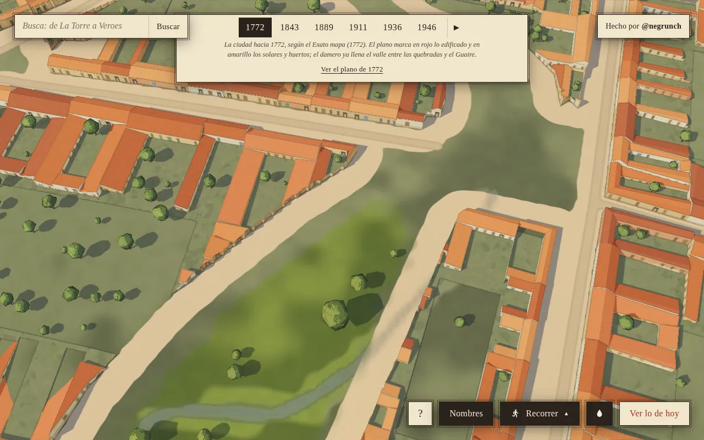
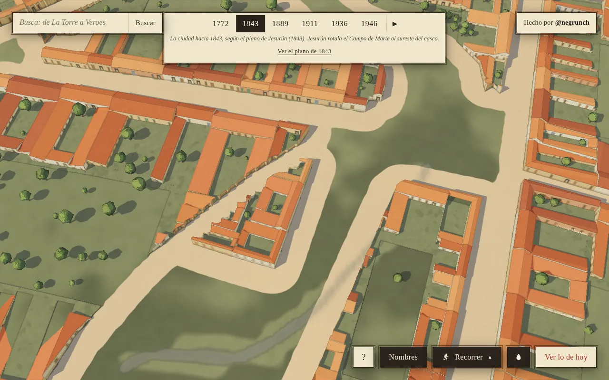
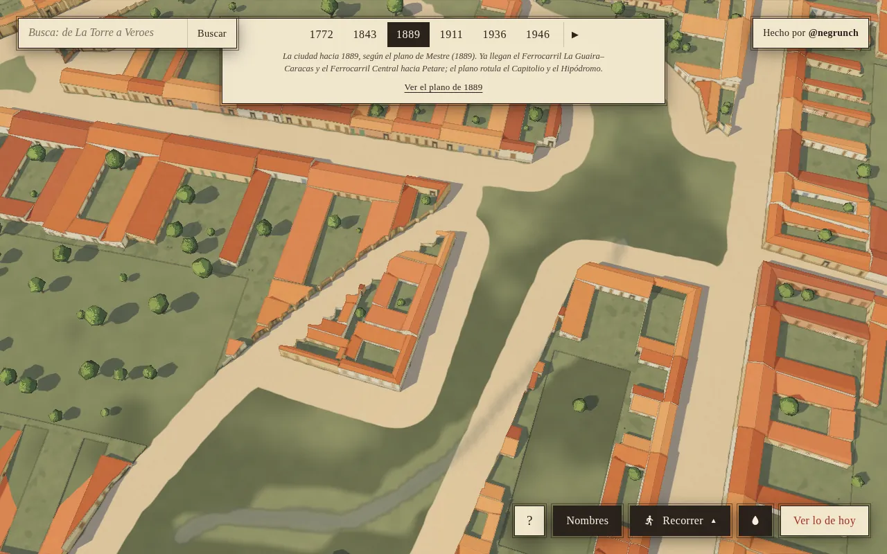
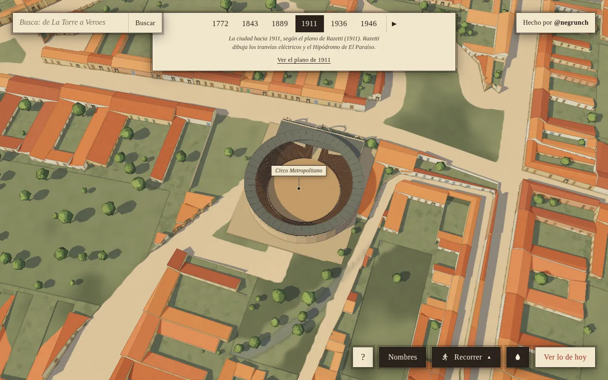
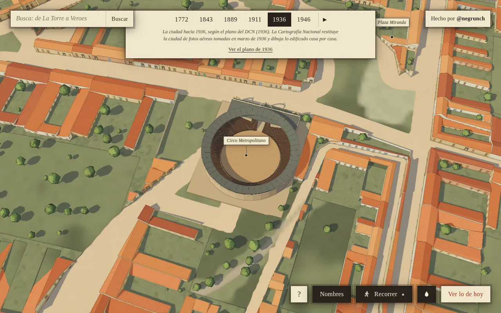
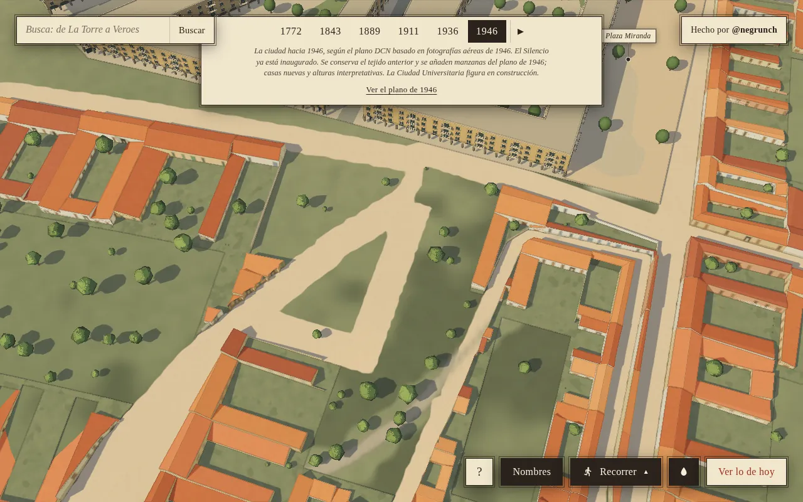

# Circo Metropolitano: integración del estudio de Miraflores

Parte de #257. Integrado por el [PR #284](https://github.com/grunch/caracas/pull/284) (fusionado el 27-11-2026); el Nuevo Circo, por #283. Son dos edificios distintos. Los datos que dependen del catálogo de hitos se regeneraron y publicaron después (`datos-2026-11-27-eb21bf8`). El 28-11-2026 se añadieron la [cronología del cierre](#cierre-y-demolición-1942-frente-a-1945) y la [lectura del solar en 1946](#el-solar-en-1946-y-las-manzanas-r13).

## Evidencia y localización

El [plano DCN de 1936](https://archive.org/details/WCWdb_18053) rotula el Circo
Metropolitano al sur de la calle entre Puerto Escondido y Miranda, al oeste de la
quebrada Caroata. Lectura del mosaico del repositorio (0,5 m/px), recorte
7500,7500–8350,8350: centro del ruedo **7909,7895**, radio exterior nominal 29 m,
eje horizontal **[-.98,-.2]**; el frente mira hacia la calle al norte.
Error visual estimado ±3 m; no es un deslinde catastral. La marca previa (7905,7905)
queda cerca del centro y no se usa como perímetro.

La [Fundación Arquitectura y Ciudad](https://fundaayc.com/category/crono-arquitectura-venezuela/1940-1949/1945/)
reproduce fotografías de fachada y documenta un ruedo de 36 m, apertura el
2 de febrero de 1896 y demolición en 1945. La ficha conserva la referencia
alternativa de 1942 sin resolver artificialmente la discrepancia.

| Época | Representación |
|---|---|
| 1772, 1843, 1889 | Sin circo ni reserva |
| 1911, 1936 | Mismo modelo; no se inventan reformas intermedias |
| 1946 | Sin circo; no se reconstruye el teatro posterior sin documentarlo |

La planta y la orientación se contrastaron con 1936. También se cotejó el
[plano de Razetti de 1911](https://maps.princeton.edu/catalog/princeton-05741v14j),
recorte equivalente del raster calzado: aparece un símbolo anular al sur de
Miranda, junto a la quebrada, en la misma cuadra. Su centro dibujado es aproximadamente
(7947,7874), unos 22 m del centro de 1936, y el símbolo tiene menor diámetro.
El calce TPS de 1911 declara RMS 6,71 m y p90 12,04 m. Esta discrepancia y la
representación esquemática no justifican inferir un traslado o una ampliación.
Se usa la huella detallada de 1936 y se declara la continuidad como hipótesis;
1911 confirma el sitio y la presencia, no las dimensiones exactas. Alturas, graderío y colores son interpretativos.

## Cierre y demolición: 1942 frente a 1945

Ninguna de las dos fechas cambia lo que muestra el visor: el circo está en 1911 y 1936 y no está en 1946.

| Fecha del hecho | Documento (fecha del documento) | Qué dice | Límite | Certeza |
|---|---|---|---|---|
| 2-02-1896 | [FAC, cronología de 1945](https://fundaayc.com/2022/06/29/1945-deja-de-funcionar-y-es-demolido-el-circo-metropolitano-de-caracas/) (página leída el 28-11-2026) | Inauguración; proyecto de Antonio Malaussena; ruedo de 36 m; madera sobre estructura de hierro; 4.000 espectadores | Fuente secundaria, sin cita de prensa de 1896 | Secundaria |
| 1942 | Alfredo Cilento, [*Caracas 1940–1960*](https://www.academia.edu/39601663/ACS_TESTIGO_PRESENCIAL_CARACAS_1940_1960) (memoria retrospectiva) | Demolido por la reurbanización | Recuerdo posterior, sin documento del año. No se releyó para este cambio: se cita por el issue #257 | Secundaria, sin cotejar |
| 19-04-1945 | Orlando Marín Castañeda, [*Valoración histórica del patrimonio arquitectónico*](https://www.academia.edu/12565798/VALORACI%C3%93N_HIST%C3%93RICA_DEL_PATRIMONIO_ARQUITECT%C3%93NICO_Estudio_de_Casos_en_el_Centro_Hist%C3%B3rico_de_Caracas) (2011), que lo atribuye a Carlos Salas, *La fiesta brava en Caracas* (1978), pp. 169–170 | Última corrida | Ni Marín ni Salas se releyeron para este cambio (el PDF pide registro): se cita por el comentario del issue #257 del 27-11-2026. Falta la prensa de abril de 1945 | Secundaria, sin cotejar |
| 1945 | FAC, misma página | «Deja de funcionar y es demolido»; «en el terreno baldío se construyó el Teatro Metropolitano y un estacionamiento público» | La única fuente que cita la página es *La Ciudad Transfigurada* (1942), que no puede acreditar un hecho de 1945 | Secundaria |
| 1946 | [Plano DCN de fotografías de 1946](https://archive.org/details/WCWdb_18051), edición catalogada [1950?] | El sitio del ruedo está en blanco (sin edificar) dentro de su cuadra | No dice cuándo se demolió | Primaria (cartográfica) |

Si la corrida del 19-04-1945 se confirma en la prensa, 1942 queda descartado como año de demolición. Hasta entonces
la ficha dice que 1945 tiene más apoyos (FAC, leída; Marín y Salas, de segunda mano) sin darla por comprobada, y
deja anotada la de 1942. **Falta:** leer directamente a Salas
(1978) o la prensa de abril de 1945. La *Guía de Caracas* de Arreaza (1942) podría decir si seguía en pie, pero su
ejemplar está restringido (`fuentes/mapas/1942-princeton-guia-de-caracas-arreaza/ficha.json`).

## El solar en 1946 y las manzanas (R13)

Lectura del 28-11-2026 sobre el mosaico DCN de 1936 (0,5 m/px) y el plano de 1946 calzado (nivel «grande»,
1,14 m/px; calce RMS 2,07 m), recorte 7650,7635–8170,8155:

- **1936.** El anillo cae dentro del vacío interior de su cuadra (blanco en el plano), entre la calle Oeste al norte,
  el callejón «H» al oeste y la quebrada Caroata al sureste. El círculo exterior del modelo (29 m de radio) coincide
  con el anillo dibujado: la posición del hito es la del plano y no se mueve.
- **1946.** Donde estuvo el circo el plano deja un solar en blanco, sin edificar; el resto de la cuadra sigue
  edificado. Coincide con el «terreno baldío» que describe FAC. El visor no levanta nada ahí en 1946, y no se
  inventa el teatro posterior.
- **Por qué mide «a caballo» (R13).** La cuadra real es una sola, pero en los datos está partida en tres polígonos
  según la época en que nació cada pedazo: `M4-0353-A0` (1911, 41 % del recinto del circo), `U1843-0224-A0` (1843,
  24 %) y `V1772-36189-0-0` (1772, 9 %). El circo no pisa el borde de una cuadra: pisa las costuras entre esos
  pedazos. La tabla de [`manzanas-hitos.md`](manzanas-hitos.md) retira `U1843-0224-A0` (51 % ocupada) en 1911 y
  1936 y deja el cruce con `M4-0353-A0` como límite. Eso no cambia acá.
- **El solar vuelve en 1946 (PR #315).** Con los datos publicados hasta el 28-11-2026, en 1946 `U1843-0224-A0` no
  volvía aunque el circo ya no estaba: quedaba un hueco de unos 1.365 m² con un lazo de suelo de calle y un árbol del
  plano en (7856, 7969) px (captura `metropolitano-1946.webp`, de antes del arreglo). `tools/manzanas-modernas.mjs`
  descartaba las retiradas que ya ningún hito retiraba. Ahora vuelven como manzana: suelo de manzana, sin casas ni
  árboles generados (el solar en blanco del plano). Detalle, medición de las seis épocas y capturas de antes y después
  en [`manzanas-hitos.md`](manzanas-hitos.md#cuando-el-hito-ya-no-está-la-manzana-vuelve). **Falta regenerar y
  publicar los datos.** Queda igual la banda de calle entre los tres pedazos de la cuadra, que el plano no dibuja.

### Capturas de las seis épocas

Misma cámara (centro 7909,7895 px, 300 m de distancia), `main` con los datos regenerados con R13 (`09730ac`),
28-11-2026. El circo está en 1911 y 1936; en 1946 queda el hueco descrito arriba.

| 1772 | 1843 | 1889 |
| --- | --- | --- |
|  |  |  |

| 1911 | 1936 | 1946 |
| --- | --- | --- |
|  |  |  |

## Instalación

El estudio previo está en `../miraflores/src/patrimonio-prioritario.js`, función
`metropolitano`, con guía `../miraflores/docs/prioridades/metropolitano.md`.
Se extrajo a `src/hitos/metropolitano-modelo.js`: metros, +Y arriba, +Z frente.
Comparte las primitivas del Nuevo Circo sin copiar los otros estudios ni cargar GLB.
El adaptador entrega geometría y colores lineales al lienzo existente.

Registro al final de HITOS para no cambiar las semillas de los edificios existentes.
Vida [4,6), reserva circular más portada, colisiones anulares dejando libre el ruedo.
Terraza y pavimento 58 × 66 m. La reserva no es toda la manzana ni la terraza:
no alcanza la quebrada ni borra solares vecinos por pertenecer a la misma cuadra.
Una casa genérica anterior se corta en 1911; no se le inventa una reaparición en
1946. Las casas cuya vida empieza en 1946 conservan esa vida.

Las fotografías y el escaneo se consultan, no se redistribuyen como texturas:
para DCN/FAC no se ha establecido aquí licencia libre. Princeton declara
«No Known Copyright» (NKC), sin determinación concluyente de derechos. Las capturas de validación son renders propios.

## Verificación

Tres regresiones: presencia y vida de todos los vértices, ruedo transitable con
colisión positiva en gradas en 1911/1936, y reserva temporal sin borrar vecinos.
El modelo suma **13.496 triángulos**. El límite de todas las fases pasa de 1.000.000
a 1.020.000, con total 1.013.085; el subconjunto anterior a 1946 pasa de 530.000
a 540.000, con total 538.044. Es un incremento explícito, no una optimización.
Medición de navegador: [comparación completa](mediciones/metropolitano/README.md).
Capturas antes/después se adjuntan al PR.

Build medido: 336,3 kB iniciales y 157,4 kB de workers; el límite inicial
pasa de 336 a 337 kB para el modelo y su ficha. No se elevan los presupuestos
de tiempo, memoria ni workers.

## Referencias visuales individualizadas

| Referencia de consulta | Procedencia/fecha | Uso y límites |
|---|---|---|
| `metropolitano-6.jpg` de Miraflores ([imagen FAC](https://fundaayc.com/wp-content/uploads/2022/07/circo-metropolitano-2.jpg)) | FAC; fotógrafo y fecha de toma no establecidos | Cinco accesos rectangulares enrejados, pilastras estriadas por bandas en el centro, cornisa y tres remates curvos de mampostería. No acredita colores. |
| `metropolitano-7.jpg` ([imagen FAC](https://fundaayc.com/wp-content/uploads/2022/06/circo-metropolitano-3.jpg)) | Pie FAC: Foto Couret, 1906, serie C nº6 | La identificación fue cuestionada en comentarios; no se usa como guía principal para reconstruir detalles. |

Licencia de ambas fotografías no establecida: solo enlaces y consulta local,
sin redistribución de las imágenes. El remate se afinó tras volver a comparar
la foto 6 con el render; la decoración menor y las rejas siguen simplificadas.

## Acceso al ruedo (revisión de PR #284)

Se representa la puerta central abierta y se reserva un paso axial entre la calle y el ruedo. El corte de las gradas, de unos 3,5 m en su extremo interior, es una interpretación funcional del modelo: las fotografías documentan las puertas, pero no permiten reconstruir la distribución interior de los accesos. No debe citarse como una medida histórica. Las gradas laterales conservan colisiones. La supresión de casas y árboles sigue cubriendo el solar completo, incluido el paso.

La regresión comprueba el recorrido con `pasoAPie` en 1911 y 1936 y un rayo a 1,7 m de altura verifica que la geometría visible tampoco tapa ese recorrido.
