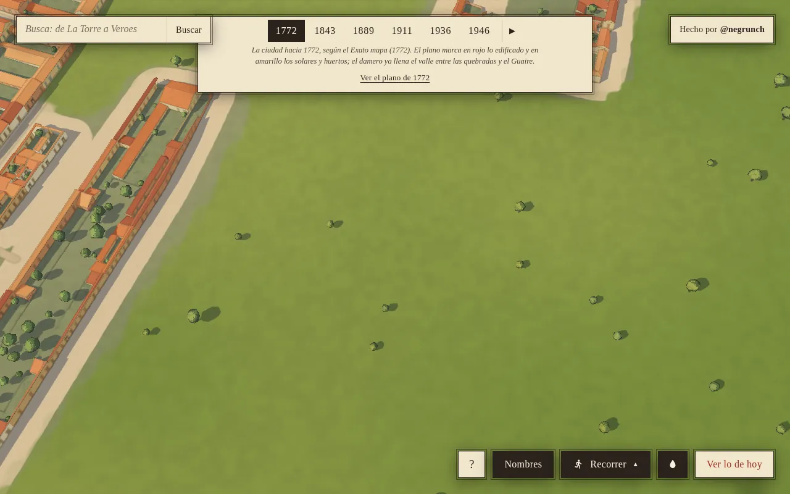
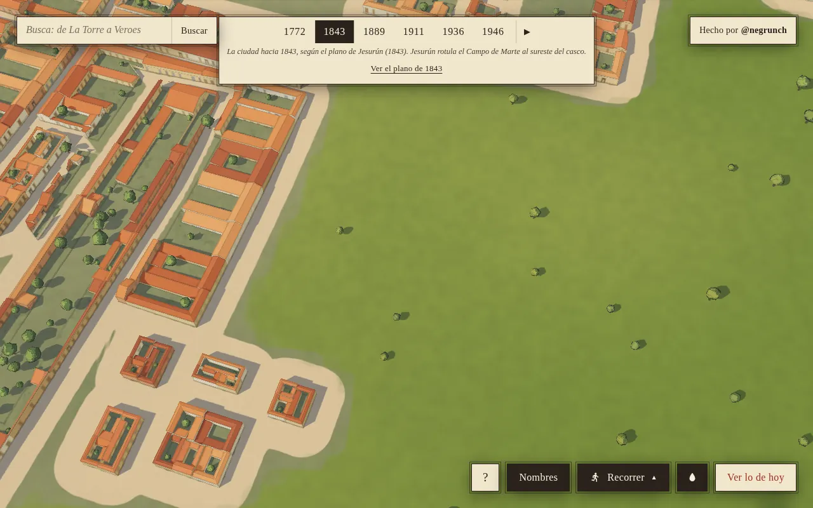
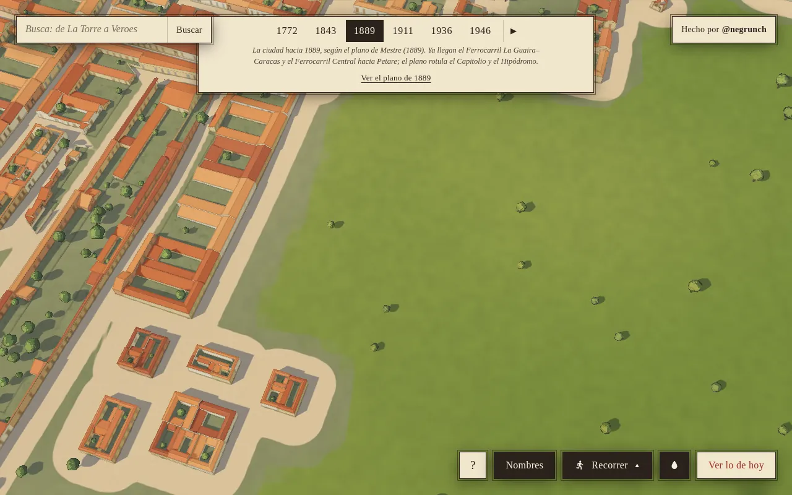
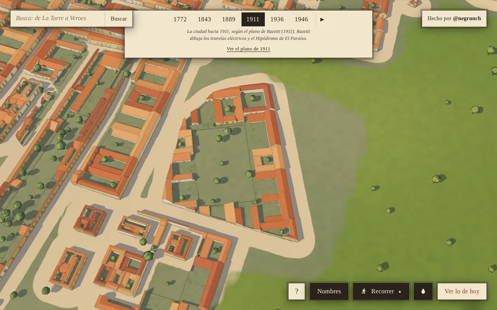
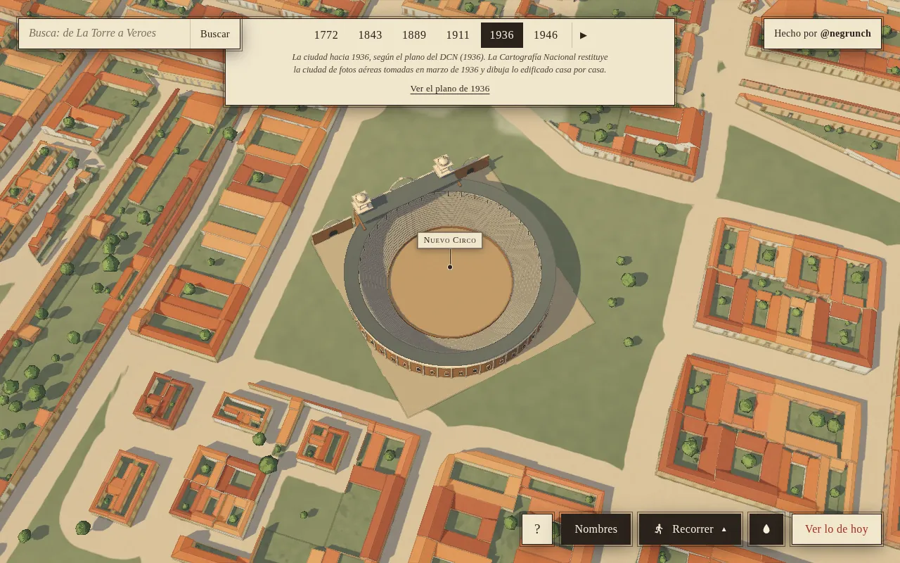
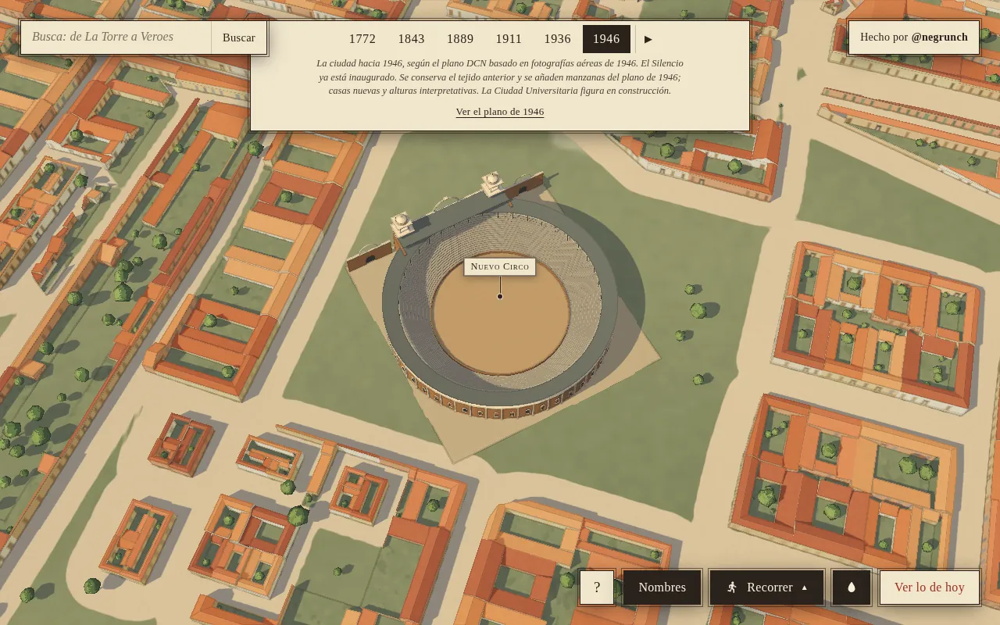

# Nuevo Circo: integración del estudio de Miraflores

Tarea T82.NC, parte de #257; integrado por el [PR #283](https://github.com/grunch/caracas/pull/283) (fusionado el 27-11-2026). Geometría desde 1936 (índice 5), conservada en 1946
(índice 6); no aparece en 1772, 1843, 1889 ni 1911. Inauguración: 26 de enero de 1919 según la Cámara de Caracas; la cronología de FAC dice 25 de enero (ver [evidencia por etapa](#evidencia-por-etapa)).

## Fuentes y calce

- [Cámara de Caracas](https://camaradecaracas.com/la-camara-caracas-y-sus-historias/cronicas-de-la-ciudad/el-nuevo-circo-de-caracas/):
  fecha inaugural, autores, ruedo sin cubierta total ejecutada y reformas posteriores
  sin fecha suficiente para asignarlas automáticamente a nuestros cortes.
- [FAC, fotografía histórica](https://fundaayc.com/category/crono-arquitectura-venezuela/1910-1919/1919/):
  portada, dos torres, balcones y remates. No se copian sus imágenes al build.
- DCN 1936, mosaico del repo, recorte `(9900,7900)–(10700,8500)`: contorno circular,
  portada diagonal al noroeste, calles San Roque / San Mateo y jardín de San Martín.
  [Documento de procedencia](https://archive.org/details/WCWdb_18053).

Centro medido visualmente: `(10316,8234)` px. Eje local X `(-.83,.56)`; +Z apunta
al noroeste. Escala del mosaico 0,5 m/px. Lectura del diámetro exterior ~88–94 m;
se adopta 88 m para la envolvente procedural. Error estimado de lectura ±3 m,
no precisión catastral. La portada del estudio se retranqueó 4 m nominales y la
planta se escaló uniformemente por 1,10; las alturas no se escalaron.

No se presume permiso de redistribuir escaneos ni fotografías: se mantienen las
licencias de las fichas originales. Las capturas del PR muestran el sitio usando
los datos existentes y el modelo propio.

## Arquitectura y adaptación

`src/hitos/nuevo-circo-modelo.js` conserva el estudio de Miraflores: ruedo abierto,
graderío anular, cubierta solo de la grada alta, portada con dos torres y balcones.
Los detalles no medidos, alturas, materiales y pigmentos siguen siendo interpretativos.
No se inventa una fecha para la reducción del ruedo o ampliación de tendidos que
relata la fuente: el modelo no certifica esas fases interiores.

Se añade al final del catálogo para conservar las semillas de todos los hitos anteriores.
El adaptador usa el lienzo existente, colores lineales y una sola parte compartida
entre épocas. La cubierta tiene espesor y caras inferiores; no depende de DoubleSide.
Gradas con menor subdivisión angular mantienen las 21 filas del estudio. No hay
loader GLB, renderer adicional ni una nueva llamada de dibujo por edificio.

## Solar, relieve y vida

La reserva es la unión de círculo y portada, no una manzana completa. El modo
`solarCompleto` significa intersección estricta con **esos polígonos**: elimina
casas que atraviesan el muro aunque sea menos del 25 % de su huella. Casas sin
intersección se conservan. La misma reserva temporal excluye árboles.

Las colisiones usan 64 sectores de corona y portada, dejando libre el ruedo.
La terraza de 88 × 93 m incluye la portada: aplica el sistema existente
de apoyo en el plano de la ladera y evita que el suelo tape el ruedo. Una plataforma de pavimento cubre todo el rectángulo para evitar huecos; su acabado
es interpretativo. No amplía los polígonos que reservan casas y árboles. El solar de 1946 se contrastó con
el plano de ese año ([abajo](#contraste-con-el-plano-de-1946)): se conserva la implantación de 1936.

## Instalación y datos

El edificio queda registrado en `hitos.js`, `partes.js` y enlazado a la marca
`nuevo-circo`. El runtime recorta las vidas de casas/árboles con las reservas,
por lo que se comprueba contra el mismo paquete publicado usado en main.

Al regenerar el pipeline, `hitosConPlanta()` transmite también la reserva al
ensamblador de manzanas. Los pasos que incluyen `CODIGO_HITOS` quedan invalidados:
no se modifica a mano `ciudad.pak` ni se publica un manifiesto simulado. Antes de
publicar un próximo release se deben regenerar las salidas dependientes y comparar
las seis épocas. Este PR no publica nuevos datos.

## Validación

- Tests de registro, geometría finita, vida 5–6, reserva temporal, vecinos,
  ruedo transitable y plataforma del solar.
- Capturas antes/después con la misma cámara en seis épocas, datos iguales.
- Presupuesto geométrico: 26.398 triángulos nuevos; total antes de 1946 524.548
  (límite explícito 530.000); incluyendo El Silencio 999.589, dentro del millón.
- Build: entrada 335,1 kB gzip, worker 156 kB. Límite de entrada 332 → 336 kB
  declarado por la geometría y metadatos añadidos; worker permanece bajo 160 kB.
- Medición del navegador en base y rama con el script del repo; el PR incorpora
  las salidas y sus limitaciones. Sin GPU no se certifican FPS.

Pendientes para cerrar #257: precisar reformas interiores, alturas y color con
evidencia, y la revisión humana cartográfica. El contraste con el documento de 1946
está hecho (abajo). No presentar la interpretación procedural como un levantamiento.

[Mediciones completas de main y rama](mediciones/nuevo-circo/README.md), incluyendo excesos y limitaciones.

Revisión #283: terraza y pavimento comparten medidas; la portada llega a b=46,5 m,
por lo que el fondo de 93 m cubre su huella completa. Tests incluyen colisión
positiva en el graderío y verificación del pavimento contra la terraza.

## Evidencia por etapa

| Fecha del hecho | Documento (fecha del documento) | Qué dice | Límite | Certeza |
|---|---|---|---|---|
| 25 o 26-01-1919 | [Cámara de Caracas, «El Nuevo Circo de Caracas»](https://camaradecaracas.com/la-camara-caracas-y-sus-historias/cronicas-de-la-ciudad/el-nuevo-circo-de-caracas/) (9-12-2021): corrida inaugural el 26 de enero. [FAC, cronología de 1919](https://fundaayc.com/2016/03/03/1919-inauguracion-del-nuevo-circo-de-caracas/): «el 25 de enero a las 4:30 p.m.» | Inauguración; proyecto de Alejandro Chataing y Luis Muñoz Tébar | Las dos páginas difieren en el día (leídas el 28-11-2026). La ficha usa el 26; la página de la Cámara lista entre sus fuentes la revista *Actualidades* (enero–marzo de 1919) y a Parra Márquez (1967), que no se consultaron, como tampoco la prensa del día | Secundarias, en desacuerdo |
| Sin fecha | Cámara de Caracas, misma página | El techo de hierro del redondel no llegó; el palco sobre la puerta de cuadrillas se derribó, los tendidos se ampliaron y el ruedo se redujo «en diferentes oportunidades» | Ninguna reforma tiene fecha: no se asigna a 1936 ni a 1946 | Secundaria |
| 1936 | [Plano DCN de 1936](https://archive.org/details/WCWdb_18053), mosaico del repo | Anillo, portada al noroeste y solar | Lectura visual ±3 m; sin alzados | Primaria (cartográfica) |
| 1946 | [Plano DCN de fotografías de 1946](https://archive.org/details/WCWdb_18051), edición catalogada [1950?] | El mismo anillo en el mismo sitio, con la portada al noroeste | Ver el contraste de abajo; sin alzados | Primaria (cartográfica) |

## Contraste con el plano de 1946

Lectura del 28-11-2026 sobre el plano de 1946 calzado por `tools/geo/mapa_1946.py` (nivel «grande», 1,14 m/px;
calce «dejando uno fuera» RMS 2,07 m, p90 3,53 m, máximo 5,06 m, `fuentes/derivados/1946/calzado.json`), recorte
10186,8104–10446,8364, con el círculo exterior del modelo (44 m de radio, centro 10316,8234) dibujado encima:

| Medida | 1936 (modelo) | 1946 (lectura) | Diferencia |
|---|---|---|---|
| Centro del anillo | (10316, 8234) px | cerca de (10324, 8231) px | unos 4 m al este y 1,5 m al norte |
| Diámetro exterior | 88 m adoptados (lectura de 88 a 94 m) | de 91 a 98 m, con un trazo de unos 3 m de grueso | las dos lecturas solapan solo en parte (91 a 94 m); la diferencia es del orden del grueso del trazo |
| Portada | Al noroeste | Al noroeste, misma diagonal | — |

La diferencia de centro es menor que el error máximo del calce (5,06 m) y del orden del error de lectura de 1936
(±3 m). El diámetro leído en 1946 es algo mayor y solo solapa en parte con el de 1936; con un trazo de 3 m y un
raster de 1,14 m/px eso no alcanza para afirmar un cambio. **No se infiere traslado ni reforma del solar entre 1936
y 1946**, y se conserva la implantación de 1936. El plano de 1946 no dibuja el cuerpo en cuña del sureste que sí está en 1936 y dibuja un elemento
rectangular chico en ese lado; a esa escala no alcanza para modelarlos, y tampoco fecha las reformas interiores.
Es una lectura a ojo sobre un raster reducido, no una medición del original.

## Referencias visuales individualizadas

| Referencia | Procedencia y fecha | Uso y límites |
|---|---|---|
| [`inauguración-del-nuevo-circo-caracas.jpg`](https://fundaayc.com/wp-content/uploads/2018/03/inauguraciocc81n-del-nuevo-circo-caracas.jpg), única imagen de la [entrada de FAC](https://fundaayc.com/2016/03/03/1919-inauguracion-del-nuevo-circo-de-caracas/) | FAC la publica sin pie: fotógrafo y fecha de toma no establecidos. Vista frontal en blanco y negro con público y automóviles | Portada: dos torres con cupulín y linterna, arco central, balcones y alas laterales bajas, que es lo que describe el estudio de Miraflores. No acredita colores ni medidas. |

Licencia no establecida: se enlaza, no se copia al repo ni al paquete de fotos. No se usó ninguna
fotografía actual como prueba de la fachada antigua.

## Capturas de las seis épocas

Misma cámara (centro 10316,8234 px, 380 m de distancia), `main` con los datos regenerados con R13 (`09730ac`),
28-11-2026. El Nuevo Circo está en 1936 y 1946; antes de 1936 el visor no lo dibuja.

| 1772 | 1843 | 1889 |
| --- | --- | --- |
|  |  |  |

| 1911 | 1936 | 1946 |
| --- | --- | --- |
|  |  |  |
