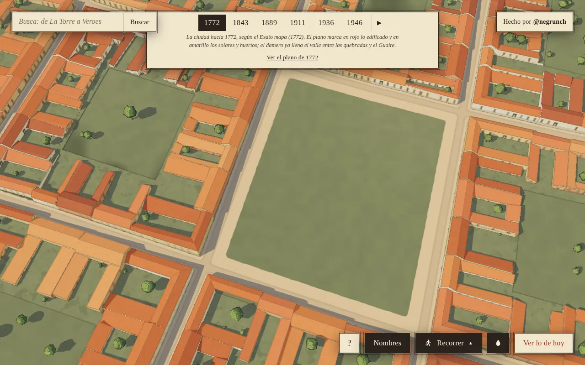
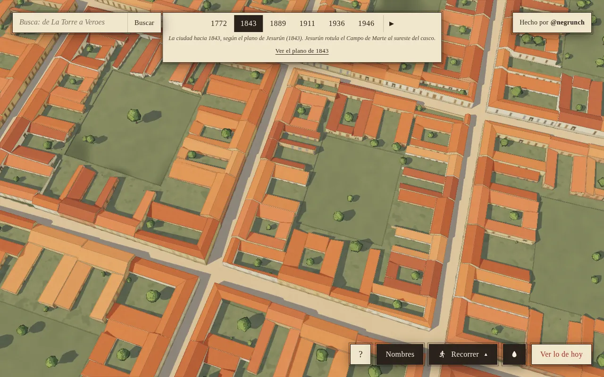
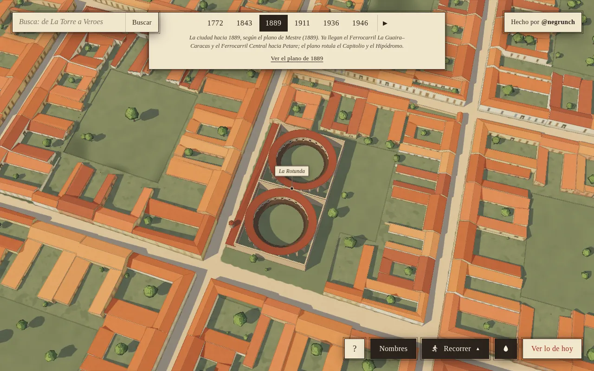
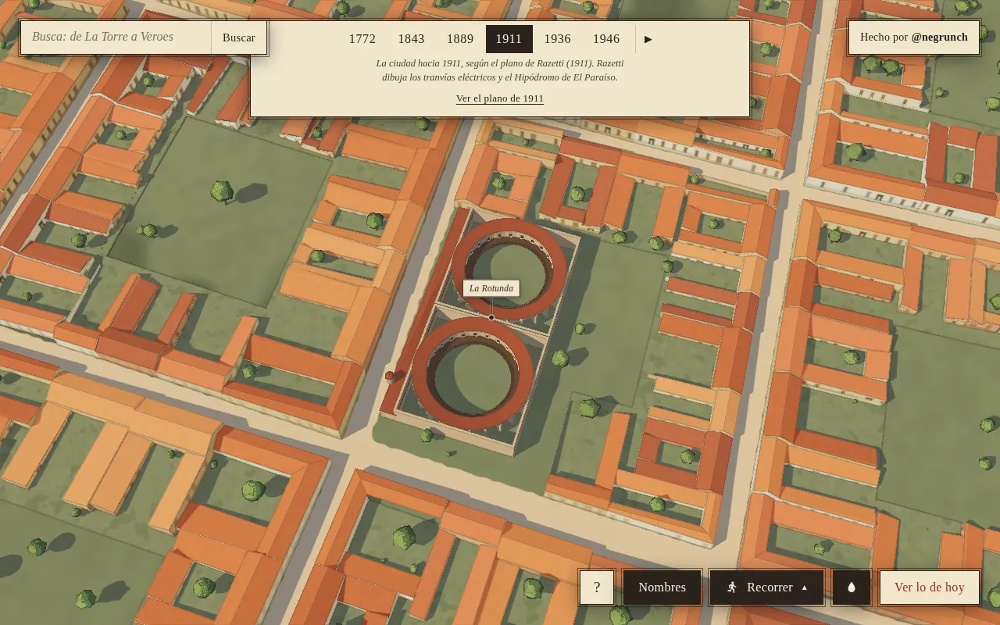
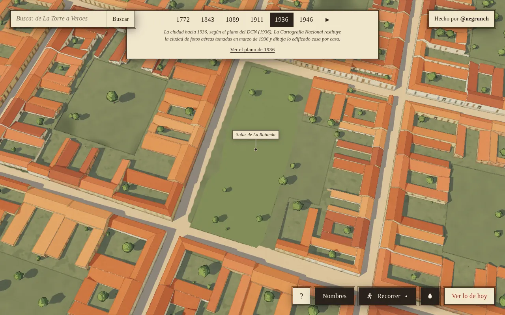
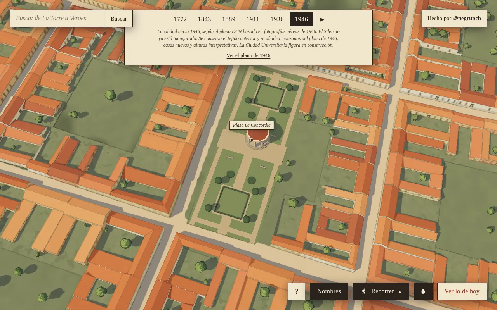

# La Concordia de Villanueva: estudio e instalación

Issue #258. Estudio creado en Miraflores e integrado por el [PR #285](https://github.com/grunch/caracas/pull/285), fusionado el 27-11-2026; los datos se regeneraron y publicaron después (`datos-2026-11-27-0c99f37`). La [transición de 1936](#la-transición-de-1936) y el [registro por imagen](#referencias-visuales-imagen-por-imagen) se añadieron el 28-11-2026.
No corresponde a la plaza remodelada de 1961 ni a su estado actual.

## Evidencia

- [Plano DCN, fotografías de 1946](https://archive.org/details/WCWdb_18051), edición catalogada [1950?]: jardines longitudinales y elemento circular central. El inmueble al este queda fuera de la plaza. Se usa la calibración existente de Caracas, no una coordenada obtenida de la marca antigua.
- [Fotografías históricas reproducidas en Caracas en Retrospectiva, 4-02-2012](https://mariafsigillo.blogspot.com/2012/02/la-rotunda-y-plaza-de-la-concordia.html): templete circular, pilares exteriores rectangulares, columnas interiores, alero y cubierta de poca pendiente, bancos y setos. Una postal acredita edición de Ora Chapellín; fechas de toma y licencia no establecidas. Consulta local en `recursos/rotunda-concordia/`, no redistribuir imágenes.
- [Polar, Carlos Raúl Villanueva](https://bibliofep.fundacionempresaspolar.org/media/1280009/200_educadores_vnzlns_lw.pdf): cronología de la plaza en 1940 (página 265 del PDF, sección dedicada a Villanueva; consultada completa el 27-11-2026). Su presencia en 1946 se apoya además en el plano. No se anticipa a 1936.

Las fotografías no son planos: dimensiones, ocho pilares y ocho columnas,
disposición de bancos y especies vegetales son interpretativos. El mapa permite
aproximar contorno y posición del templete, no reconstruir cada parterre al centímetro.

## Ver y exportar

Abrir `prioridades.html?edificio=concordia&anio=1946`, usar los botones de vista
y descargar GLB. El selector también permite comparar con La Rotunda. El modelo
se construye mediante `construirConcordia` de `src/patrimonio-concordia.js`;
`crearPatrimonio({id:'concordia',anio:1946,nivelDetalle:'ciudad'})` agrupa sus mallas.

Las capturas propias están en `entregables/concordia/`. La fase es exclusiva
para 1946 en las épocas disponibles; las pruebas impiden su aparición en 1936.

## Instalar en Caracas

1. Copiar el constructor a `src/hitos/concordia-modelo.js`, reutilizando el taller del Nuevo Circo. El adaptador usa el lienzo compartido; no cargar GLB ni crear otro renderer.
2. Ancla de estudio: (8595,8478), eje [.98,.2] en píxeles del mosaico DCN1936. Rectángulo nominal 44×124 m; centro del templete local (2,-7), próximo al círculo del mapa. Error visual aproximado varios metros, no catastro.
3. Registrar `concordia` con vida [6,0), reserva de la franja occidental y colisión solo del basamento del templete. No suprimir el edificio oriental. Reemplazar los árboles genéricos interiores por la vegetación del jardín para evitar solapes.
4. Registrar por separado `rotunda` [3,5) y `solar-rotunda` [5,6). La cárcel ocupa solo su parcela sur, no el Cuartel del Hoyo. El solar reproduce la zona libre del plano de 1936 sin inventar ruinas ni un templete prematuro.
5. Añadir marcas/fichas, pruebas de vida/colisiones/reservas y comparación de las seis épocas. Medir geometría, carga y build; adjuntar capturas al PR ready y atender revisiones antes de fusionar.
6. Tras fusión, regenerar/publicar los derivados que consuman HITOS según el procedimiento de Caracas. No cerrar el issue hasta verificar todo su alcance.

## Precisión del calce

Con `tools/geo/mapa_1946.py:calibrar`, el círculo inspeccionado en el original
(6573,5682) se transforma aproximadamente a (8601.7,8465.2). El contorno leído
produce esquinas próximas a (8578,8347), (8665,8365), (8614,8610), (8523,8591).
Se aproxima con el rectángulo nominal; no se confunden coordenadas del original
con las del mosaico base. La licencia del escaneo consta como dudosa en su ficha;
solo los renders propios acompañan el PR.

## Presupuesto de geometría

La cárcel añade 23.860 triángulos, el solar 12 y la plaza 4.332. El total compartido anterior a 1946 pasa de 538.044 a 561.916; el total de hitos de todas las épocas pasa de 1.013.085 a 1.041.289 (+2,78 %). Los límites unitarios quedan en 570.000 y 1.050.000, respectivamente. La plaza se carga con los hitos de 1946, sin adelantar esa carga al arranque histórico. Son recuentos geométricos; no representan FPS ni una medición de GPU.

El relieve usa un único plano de apoyo para la franja de La Concordia. Los dos edificios se apoyan en él; la cárcel no recorta el terreno porque sus esquinas entre celdas y muro quedan descubiertas. Solo la plataforma continua del jardín tapa el suelo en 1946. Se amplía de cuatro a cinco la capacidad de terrazas del shader, con una prueba del catálogo completo para evitar fallos de arranque.

## Evidencia por etapa

| Época | Estado usado | Documento y precisión | Límite |
|---|---|---|---|
| 1772 / 1843 | Sin cárcel | Polar: orden de diciembre de 1843, construcción 1844–1854 | La orden no equivale a edificio terminado. |
| 1889 | Cárcel en parcela 30 | Plano Mestre de 1889; proyecto de ampliación norte de 1881 descrito por Polar | Dos recintos interpretativos: no se verificó la fecha exacta de terminación de la ampliación. |
| 1911 | Cárcel en parcela 39 | Razetti: cárcel 39 y Cuartel del Hoyo 40 separados | Escala de parcela aproximada; alturas y fachada no son un levantamiento. |
| 1936 | Solar occidental libre | Plano DCN de 1936 cotejado (vuelo de marzo, restitución de marzo a diciembre); inmueble oriental preservado. *La Nación*, 12-04-1936: la demolición comenzó el 11 de abril | El plano no fecha el derribo y su vuelo es anterior al inicio de la demolición: contradicción abierta (ver abajo). No consta cuándo terminó el derribo; verde convencional, sin inferencia botánica. |
| 1946 | Jardín y templete | Plano DCN de fotografías aéreas de 1946, edición catalogada [1950?]; fotografías históricas del templete | Jardín esquemático; fecha de toma y licencia de fotos desconocidas; no se redistribuyen. |

La fuente de la cárcel es el [Diccionario de Historia de Venezuela, «La Rotunda»](https://bibliofep.fundacionempresaspolar.org/dhv/entradas/l/la-rotunda/), de Ermila Troconis de Veracoechea. La [cronología de Polar para 1936](https://bibliofep.fundacionempresaspolar.org/_custom/static/cronologia_hv/zoom/s20/1936-15.html) registra una resolución del MOP en abril, mientras la transcripción secundaria del blog atribuye un decreto al 2 de enero. Son actos administrativos que no prueban por sí mismos el momento del derribo. Una referencia secundaria a enero de 1937 queda pendiente de cotejo y no modifica el estado observado en el plano.

## La transición de 1936

La época «1936» del visor es el plano DCN, no un día del año. Lo que se sabe de ese año, por fecha del hecho:

| Fecha del hecho | Documento (fecha del documento) | Qué dice | Qué no demuestra | Certeza |
|---|---|---|---|---|
| 2-01-1936 | Transcripción en [Caracas en Retrospectiva](https://mariafsigillo.blogspot.com/2012/02/la-rotunda-y-plaza-de-la-concordia.html) (2012), que lo atribuye a la Gaceta Oficial 18.843 | Decreto que ordena demoler la cárcel | Que el derribo empezara entonces. La Gaceta no se consultó | Secundaria, sin cotejar |
| Marzo de 1936 | Leyenda del [plano DCN de 1936](https://archive.org/details/WCWdb_18053), según `fuentes/mapas/1936-archiveorg-caracas-dcn-hoja1/ficha.json` | El plano se fotografió en marzo de 1936 y se restituyó de marzo a diciembre de 1936 | Qué día se voló este sector ni si el dibujo se corrigió después del vuelo | Primaria (leyenda de la hoja) |
| Abril de 1936 | [Cronología de Polar para 1936](https://bibliofep.fundacionempresaspolar.org/_custom/static/cronologia_hv/zoom/s20/1936-15.html), que cita la Gaceta Oficial 18.921 | Resolución del Ministerio de Obras Públicas sobre la demolición | El día en que empezó la obra | Secundaria |
| 11-04-1936 | *La Nación*, 12-04-1936, despacho de United Press fechado «Caracas, 11» (facsímil digitalizado por Cultura Digital UDP; página 12 del PDF) | «Comenzó hoy la demolición de la Rotunda»; el espacio libre «se convertirá en la Plaza de la Concordia» | Que el edificio estuviera derribado ese día ni cuándo terminó el derribo | Primaria (prensa del día siguiente), leída en el facsímil el 28-11-2026 |
| 1936, sin día | [Diccionario de Historia de Venezuela, «La Rotunda»](https://bibliofep.fundacionempresaspolar.org/dhv/entradas/l/la-rotunda/) | Demolida en 1936 | Mes de inicio o de fin | Secundaria |

El facsímil de *La Nación* ya no responde en su dirección original
(`https://culturadigital.udp.cl/dev/wp-content/uploads/2019/06/LN_1936_04_12.pdf`, 404 el 28-11-2026); se leyó en la
[copia de Wayback Machine del 30-11-2024](https://web.archive.org/web/20241130142527/https://culturadigital.udp.cl/dev/wp-content/uploads/2019/06/LN_1936_04_12.pdf).
El comentario del issue la ubicaba en la página 14 del PDF; en esa copia el despacho está en la página 12.

**Contradicción abierta.** El plano DCN dice que se fotografió en marzo de 1936, cuando la cárcel seguía en pie
(la demolición comenzó el 11 de abril), pero dibuja libre la franja occidental. Caben al menos dos explicaciones y
ninguna está probada: que la restitución, que duró hasta diciembre, se pusiera al día con la demolición ya conocida,
o que el vuelo de ese sector fuera posterior a marzo. No se resuelve acá. El visor sigue al plano: en 1936 muestra
el solar libre, y la ficha dice que la cárcel estuvo en pie hasta abril de ese año.

**Qué falta para precisar la transición** (no se cambia ninguna vida ni fase hasta tenerlo): la fecha en que
terminó el derribo; la fecha de vuelo y de dibujo de este sector de la hoja DCN; el texto de las Gacetas 18.843 y
18.921; y el cotejo de la referencia secundaria a enero de 1937.

## Capturas de las seis épocas

Misma cámara (centro 8592,8490 px, 320 m de distancia), `main` con los datos regenerados con R13 (`09730ac`),
28-11-2026: sin cárcel en 1772 y 1843, la cárcel en 1889 y 1911, el solar libre en 1936 y la plaza en 1946.

| 1772 | 1843 | 1889 |
| --- | --- | --- |
|  |  |  |

| 1911 | 1936 | 1946 |
| --- | --- | --- |
|  |  |  |

## Referencias visuales, imagen por imagen

Las cinco fotografías que se consultaron para el estudio (registradas en Miraflores,
`recursos/rotunda-concordia/ficha.json`) salen de una sola entrada de blog,
[«La Rotunda y Plaza de La Concordia», Caracas en Retrospectiva, 4-02-2012](https://mariafsigillo.blogspot.com/2012/02/la-rotunda-y-plaza-de-la-concordia.html).
Ninguna entró al paquete de fotos del sitio ni a `fuentes/imagenes/`: sin licencia establecida no se redistribuyen.
No se usó ninguna fotografía actual como prueba de una fachada antigua.

| Imagen (nombre del archivo en el blog) | Qué muestra | Fecha de la toma | Autor o procedencia | Licencia |
|---|---|---|---|---|
| `LA ROTUNDA 009 mfachada.jpg` | Fachada de dos pisos sobre la calle, con portón de arco almohadillado y gente en la acera | No establecida | No establecido; reproducida por el blog | No establecida |
| `LA ROTUNDA 007.jpg` | Interior: dos niveles de celdas numeradas con puertas de arco y galería de madera | No establecida | No establecido; reproducida por el blog | No establecida |
| `concordia hermosa.jpg` | Postal del templete circular: pilares exteriores, columnas interiores y cubierta baja; al fondo, la torre de un templo | No establecida | No establecido; reproducida por el blog | No establecida |
| `la concordia.jpg` | El templete entre setos, con un banco | No establecida | No establecido; reproducida por el blog | No establecida |
| `plaza concordia Ora Chapellin.jpg` | Impreso con pie de foto: la plaza y el templete; el pie dice que se construyó en el sitio de La Rotunda durante el gobierno de López Contreras | No establecida | Marca de agua «Ora Chapellín» sobre la imagen; impreso de origen no identificado | No establecida |

Las descripciones son de lo que se ve en las copias de consulta (miradas el 28-11-2026); las fechas de toma y los
autores no constan y no se suponen. Las dos de la cárcel son anteriores a su demolición (abril de 1936) y las tres
de la plaza, posteriores a su construcción; nada más se puede fechar con ellas.

Los patios descubiertos de La Rotunda conservan el suelo verde convencional de las manzanas del visor. El modelo urbano no superpone discos de pavimento a ese terreno; la vista de estudio de Miraflores emplea el mismo verde. Esto es una convención visual del proyecto, no una afirmación de que los patios históricos fueran césped.
